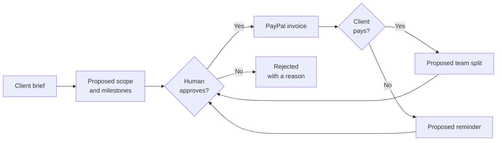

# Part 1 — Overview

> [Handbook index](../README.md) · **Part 1 of 9**

This part explains what Vizlify is, who it is for, what is actually built, and
which technologies it uses.

## Chapters

1. [What is Vizlify?](./what-is-vizlify.md) — the problem, the actors and the
   safety promise.
2. [Product and scope](./product-scope.md) — every feature area with an honest
   status.
3. [Tech stack](./tech-stack.md) — every runtime, library and service, with
   versions and the reason it exists.

## The one-minute version

Freelance agencies lose hours writing invoices, chasing late payers and
splitting money. Vizlify turns those tasks into **proposals**: the agent drafts
the scope, the invoice, the reminder or the payout split, and a human approves
it before PayPal is called.

Everything that moves money or contacts a client passes through the same gate.
That gate is the product.
