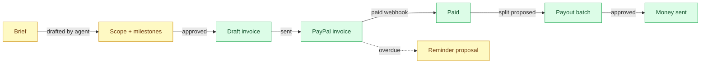

# Product and scope

> [Handbook index](../README.md) · [Part 1](./README.md) · **Status: living document**

This chapter is the truth about what Vizlify does today. It is deliberately
conservative: a feature is only **Implemented** when code and tests exist.

## What works today

| Capability | Where | Evidence |
|------------|-------|----------|
| One-command local stack | `compose.yaml` | `db`, `api`, `web` start with health checks |
| Clerk authentication | `backend/app/auth/` | Signed-in users map to local `users` rows |
| Key-free local mode | `AUTH_MODE=dev` | Seeded demo user, refused in production |
| Clients CRUD | `/clients` | Owner-scoped, 8 tests |
| Projects CRUD | `/projects` | Owner-scoped, 4 tests |
| Milestones CRUD | `/projects/{id}/milestones` | Owner-scoped, 5 tests |
| Team members and splits | `/projects/{id}/team` | Shares cannot exceed 100%, 3 tests |
| Full database schema | Alembic | All 12 tables from the roadmap data model |
| Demo agency seed | `python -m app.scripts.seed` | Idempotent, validated JSON fixture |
| PayPal transport | `backend/app/paypal/` | OAuth cache, retries, idempotency, mock mode, 33 tests |
| Approval queue and executor | `/actions` | Propose, approve, reject, `409`, audit, spend caps, 8 tests |
| Invoicing | `/invoices` | Create/send, list/detail, remind, cancel, refresh, 6 tests |
| Webhooks | `/webhooks/paypal` | Signature verification, dedupe, invoice and payout handlers, 4 tests |
| Payouts and splits | `/payouts` | Largest-remainder split, prepare, execute, 10 tests |
| Frontend API layer | `frontend/lib/api/` | Envelope-aware client, typed errors, CRUD + money query hooks |
| Frontend providers | `frontend/components/providers/` | Optional Clerk, theme, TanStack Query, API client |
| Money Board screen | `/dashboard` | Approvals, invoices, payouts, sandbox banner |

The backend suite is **108 tests** with roughly **91% statement coverage**
(`cd backend && uv run pytest`). The full mock money loop was verified against
Docker on 2026-10-21.

## What is scaffolded

| Area | What exists | What is missing |
|------|-------------|-----------------|
| Next.js UI | App Router shell, layout, providers, buttons, states, money query hooks | Screens: dashboard, approvals, invoices, payouts |
| Demo mode | Seed script, `DEMO_MODE` flag, `LLM_MODE=mock` | Time travel, reset button, judge walkthrough |
| Sandbox verification | Mock PayPal path fully tested | Real keys, tunnel and a paid sandbox invoice |
| API docs | FastAPI's `/docs` and `/openapi.json` | A generated typed frontend SDK |

## What is planned

The roadmap defines sixteen epics. This table tracks them at a glance; the
authoritative, day-by-day plan is in [ROADMAP.md](../../ROADMAP.md).

| Epic | Area | Status | Notes |
|------|------|--------|-------|
| E1 | Platform foundation | **Implemented** | Compose, config, auth, errors, seed |
| E2 | Clients, projects, milestones, team | **Implemented** | Payment-behaviour score and timelines are not |
| E3 | AI scope from a brief | **Planned** | Needs LLM client, structured output, eval harness |
| E4 | Invoicing | **Implemented** | Create/send, list/detail, remind, cancel, refresh; UI missing |
| E5 | Payments and webhooks | **Implemented** | Signature verification, dedupe, invoice/payout handlers |
| E6 | Payouts and splits | **Implemented** | Largest-remainder split, batch, item statuses; freelancer view missing |
| E7 | Approval queue and executor | **Implemented** | Proposals, `409`, audit, spend caps; kill switch and step-up missing |
| E8 | Collections and nudge-bot | **Planned** | Overdue sweep, tone-aware drafts |
| E9 | Disputes | **Planned** | Ingest, summarise, draft response |
| E10 | Finance chat and Studio agent | **Planned** | Tool calling, proposals, NL-to-widget |
| E11 | Dashboard (AG Studio) | **Planned** | Needs an AG Studio trial key |
| E12 | Notifications | **Planned** | In-app centre, email |
| E13 | Demo and judge mode | **Scaffolded** | Seed works; time travel and reset do not |
| E14 | Reconciliation and reporting | **Planned** | Nightly reconcile, statements |
| E15 | Agentic commerce and interoperability | **Planned** | MCP server, outbound webhooks, API keys |
| E16 | API and documentation | **Scaffolded** | OpenAPI is live; this handbook is the docs portal; SDK is planned |

## The money loop

The product is one loop. Solid arrows exist today; dashed arrows do not.

Status at the time of writing: the **billing and payout half of this loop is
implemented and tested against mock PayPal** — approval queue, invoice create
and send, paid webhook, split calculation and payout execution. The AI half
(brief → scope) and the nudge-bot are still planned. Real sandbox verification
waits on PayPal keys; see [`TODO.md`](../../TODO.md) and
[Project status](../09-project/status-and-roadmap.md).

## Scope discipline

The hackathon plan uses tiers: **P0 must**, **P1 should**, **P2 stretch**. When
time runs short, P2 is cut first, then P1. No P0 is cut, because each one
appears in the three-minute demo.

The same rule applies to documentation: a page that describes a P0 incorrectly
is a worse bug than a missing P2 page.

Next: [Tech stack](./tech-stack.md) →
