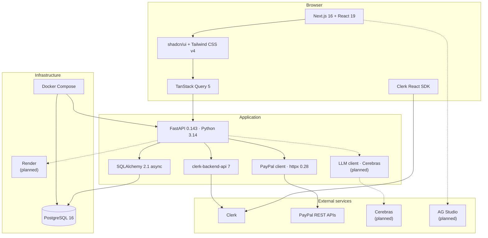

# Tech stack

> [Handbook index](../README.md) · [Part 1](./README.md) · **Status: Implemented**

Every technology below is either in use today or explicitly marked planned.
Versions come from `frontend/package.json`, `backend/pyproject.toml` and
`compose.yaml`.

## At a glance

## Frontend

| Technology | Version | Why it is here |
|------------|---------|----------------|
| **Next.js** | 16.4.0 (App Router) | Server rendering, routing, a single deployment target for the UI |
| **React** | 19.3.0 | UI runtime with the current concurrent features |
| **TypeScript** | 5.x | Types across the API boundary and the query layer |
| **Tailwind CSS** | 4.x | Utility styling without a separate CSS build |
| **shadcn/ui** | CLI 4.22 | Accessible primitives copied into the repo, not a black-box UI kit |
| **Base UI** | 1.9.0 | Headless primitives underneath the shadcn components |
| **lucide-react** | 1.59 | Consistent icon set |
| **next-themes** | 0.4.6 | Class-based dark mode without hydration flicker |
| **TanStack Query** | 5.104 | Server-state cache, retries, optimistic updates |
| **TanStack Query Devtools** | 5.104 | Inspecting cache and mutations during development |
| **Clerk React SDK** | 7.9.17 | Hosted sign-in, session tokens, user button |
| **bun** | 1.x | Install and dev server; lockfile is `bun.lock` |
| **ESLint** | 9 (flat config) | Next.js and TanStack Query rules |
| **Prettier** | 3.9 + Tailwind plugin | Deterministic formatting and class ordering |
| **Playwright** | *(planned)* | End-to-end coverage of the critical money path |

## Backend

| Technology | Version | Why it is here |
|------------|---------|----------------|
| **Python** | 3.14 | Current language features; async everywhere |
| **FastAPI** | 0.143+ | Typed HTTP layer, dependency injection, automatic OpenAPI |
| **Pydantic** | v2 (via `pydantic-settings` 2.16) | Request/response schemas and fail-fast config validation |
| **SQLAlchemy** | 2.1 (async, `asyncpg` driver) | Explicit models and queries without a second DSL |
| **Alembic** | 1.20 | Versioned schema changes |
| **PostgreSQL** | 16 | `NUMERIC`, JSONB, real constraints; parity with production |
| **httpx** | 0.28 | Async HTTP for PayPal, with injectable transports for tests |
| **clerk-backend-api** | 7.0 | Networkless session verification against Clerk's public key |
| **uvicorn** | 0.54 (`standard`) | ASGI server in Docker and locally |
| **uv** | current | Lockfile-driven Python environments |
| **pytest** | 9 | Test runner |
| **pytest-asyncio** | 1.4 | Async tests (`asyncio_mode = auto`) |
| **pytest-cov** | 7 | Coverage gate and report |
| **aiosqlite** | 0.22 | In-memory SQLite for fast, isolated tests |
| **ruff** | 0.17 | Linting and formatting (line length 100, `py314`) |

## Data and integrations

| Technology | Version / API | Use |
|------------|---------------|-----|
| **PayPal Invoicing** | REST v2 | Generate numbers, create, send, remind, cancel invoices *(client ready, routes planned)* |
| **PayPal Payouts** | REST v1 | Batch payouts with `sender_batch_id` and `PayPal-Request-Id` *(client ready, routes planned)* |
| **PayPal Webhooks** | Notifications v1 | Signature verification and event dedupe *(planned)* |
| **Clerk** | Backend API v7 | Session verification and user provisioning |
| **Cerebras** | OpenAI-compatible API | Scope extraction, reminders, chat *(planned)* |
| **AG Studio (AG Grid)** | commercial | Money Board dashboard and Studio agent *(planned, needs a trial key)* |
| **APIMatic** | PayPal Context Plugin | Integration reference and judging evidence *(manual process)* |

## Infrastructure

| Technology | Status | Note |
|------------|--------|------|
| **Docker Compose** | Implemented | One command: Postgres 16, API, web |
| **Multi-stage Dockerfiles** | Implemented | `backend/Dockerfile`, `frontend/Dockerfile` |
| **Render** | Planned | API, Postgres, web, cron job and Workflows |
| **GitHub Actions** | Planned | Lint, typecheck, tests on every push |
| **Sentry** | Planned | Error tracking for the hosted demo |

## Deliberate omissions

- **No generated PayPal SDK.** The official Python SDK is synchronous; see
  [ADR-0001](../07-decisions/adr-0001-thin-paypal-client.md).
- **No Redux/Zustand for server data.** TanStack Query owns it; see
  [ADR-0003](../07-decisions/adr-0003-tanstack-query.md).
- **No custom auth implementation.** Clerk handles sessions; the backend only
  verifies tokens and provisions users.
- **No ORM magic in routes.** Routers validate and delegate; services own
  queries and transactions.

Next: [Quick start](../02-getting-started/quick-start.md) →
