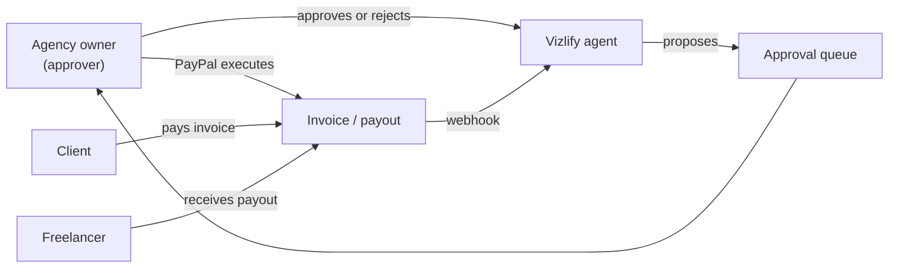

# What is Vizlify?

> [Handbook index](../README.md) · [Part 1](./README.md) · **Status: Scaffolded**

Vizlify is an AI finance agent for small freelance agencies. It handles the
money work an agency does every month: scoping a project, invoicing milestones,
chasing overdue payments, and splitting incoming money across the team.

The agent never executes anything on its own. Every action that moves money or
contacts a client becomes a **proposal** in an approval queue. A human approves
or rejects it, and only then does PayPal get called.

> **Sandbox only.** The hackathon version uses PayPal's sandbox. No real money
> moves.

## The problem

A three-person agency with ten active clients typically:

- writes 10–20 invoices a month by hand;
- spends hours deciding how firmly to chase a late payer;
- splits every payment across three people, with rounding arguments;
- keeps the truth in a spreadsheet that nobody trusts.

The work is repetitive, easy to get wrong, and has real financial consequences.
Generic chat assistants cannot help because they cannot touch money safely.

## The actors

| Actor | What they see | What they can do |
|-------|---------------|------------------|
| Agency owner | Everything in one workspace | Approve, reject, edit proposals; manage clients, projects, team |
| Freelancer | Their own payout items *(planned)* | See what they will receive |
| Client | A PayPal invoice and reminders | Pay, or ignore it |
| Agent | The agency's data through tools | Read freely; write only as a proposal |

## The promise

1. **Propose, never execute.** Write actions create a `pending_action` row with
   a rationale. Execution happens only after approval.
2. **Show the working.** Every proposal carries the data behind it: which
   invoice, which client, which split.
3. **Audit everything.** Proposals, approvals, rejections and executions append
   to an audit log. Deleting a proposal never deletes its history.
4. **Fail closed.** Missing keys, unknown modes or a production misconfiguration
   stop the app instead of silently falling back.

## The demo story

The seeded agency is **Northwind Studio**: two clients (Acme Co and Globex),
one website redesign project, three milestones totalling $12,500, and three
freelancers splitting the work 40/35/25.

The intended three-minute flow:

1. Paste Acme's brief; the agent proposes three milestones and prices.
2. Approve the first milestone; Vizlify creates and sends a PayPal invoice.
3. Pay it in the sandbox payer account.
4. The webhook marks it paid; a payout proposal appears.
5. Approve the split; PayPal sends three sandbox payouts.
6. "Time travel" two weeks; an overdue reminder proposal appears with the
   client's preferred tone.

Steps 1, 4, 5 and 6 are **planned**. Today the demo can seed the agency and
show the data model; the PayPal transport underneath is implemented but not
yet exposed through invoice endpoints. See
[Product and scope](./product-scope.md) and the
[Judge guide](../09-project/judge-guide.md).

## Design principles

| Principle | Consequence in the code |
|-----------|-------------------------|
| The human is the executor | Agent code may only create `PendingAction` rows |
| Money is exact | `NUMERIC(12,2)` in Postgres; `Decimal` in Python; never floats |
| The API is boring | One response envelope, one error shape, one auth dependency |
| The UI is a client of the API | No business rules in React; no direct database access |
| Local runs need no keys | `AUTH_MODE=dev`, `LLM_MODE=mock`, `PAYPAL_MODE=mock` |
| Judge-proof demos | Deterministic mock modes and a seeded fictional agency |

## What Vizlify is not

- Not a bank or a payment processor. PayPal holds and moves the money.
- Not an accounting system. It produces invoices and payout records.
- Not autonomous. There is no setting that lets the agent move money without a
  human, and there will not be one.

Next: [Product and scope](./product-scope.md) →
