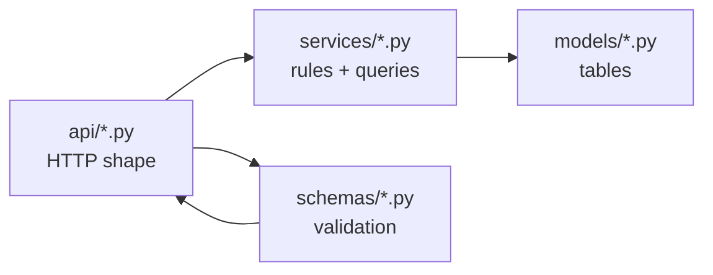

# Project structure

> [Handbook index](../README.md) · [Part 2](./README.md) · **Status: Implemented**

## Top level

```text
vizlify/
├── backend/                 FastAPI application, migrations, tests
├── frontend/                Next.js application
├── docs/                    this handbook
├── compose.yaml             three-service local stack
├── README.md                pitch, quick start, judge guide
├── ROADMAP.md               hackathon plan, day by day
├── LICENSE                  MIT
└── .env.example files       inside backend/ and frontend/
```

## Backend

```text
backend/
├── app/
│   ├── main.py              app factory, lifespan, routers
│   ├── core/                config, error envelope
│   ├── db/                  engine, session factory, Base
│   ├── models/              SQLAlchemy models and enums
│   ├── schemas/             Pydantic request/response models
│   ├── services/            queries and transactions
│   ├── api/                 thin routers
│   ├── auth/                Clerk verification, deps, provisioning
│   ├── paypal/              transport, errors, mock, dependency
│   └── scripts/             demo fixture, seed command
├── alembic/                 migration environment and versions
├── tests/                   pytest suite and fixtures
├── Dockerfile
├── pyproject.toml           dependencies, ruff, pytest config
└── .env.example
```

### The rule of three layers



- **Routers** parse, authenticate and delegate. No business rules.
- **Services** own queries, ownership checks and transactions.
- **Models** own the schema, relationships and enums.

New feature? Add a schema, a service and a router in that order. If a router
starts containing an `if` about money, the rule was broken.

## Frontend

```text
frontend/
├── app/
│   ├── layout.tsx           providers, fonts, header
│   ├── page.tsx             starter page (real screens pending)
│   └── globals.css          Tailwind v4 theme tokens
├── components/
│   ├── providers/           Clerk, theme, Query, API client
│   ├── query/               shared loading/error/empty states
│   └── ui/                  shadcn/ui components
├── lib/
│   ├── api/                 HTTP client + per-domain query hooks
│   ├── query/               QueryClient defaults
│   └── format.ts            money, date, relative time
├── hooks/                   future shared hooks
├── public/
├── proxy.ts                 Clerk middleware
├── next.config.ts
└── package.json
```

The important boundary: **`app/` renders; `lib/api/` talks to the server.**
Components never call `fetch` directly and never know the response envelope.

## Docs

```text
docs/
├── README.md                the handbook index
├── 01-overview/
├── 02-getting-started/
├── 03-architecture/
├── 04-backend/
├── 05-frontend/
├── 06-operations/
├── 07-decisions/
├── 08-reference/
└── 09-project/
```

Each part has its own `README.md` with a chapter list and a "what you will
learn" line. Chapters link back to the index so no page is a dead end.

## Naming conventions

| Thing | Convention | Example |
|-------|------------|---------|
| Python modules | `snake_case` | `paypal_client.md`, `team_member.py` |
| Python classes | `PascalCase` | `PayPalClient`, `TeamMemberCreate` |
| React components | `PascalCase` files | `QueryProvider`, `DataState` |
| Hooks | `use*` | `useClients`, `useCreateProject` |
| Query keys | `domainKeys` | `clientKeys.detail(id)` |
| Database tables | plural `snake_case` | `pending_actions`, `payout_items` |
| Docs chapters | `NN-part/verb-noun.md` | `04-backend/paypal-client.md` |

Next: [System overview](../03-architecture/system-overview.md) →
