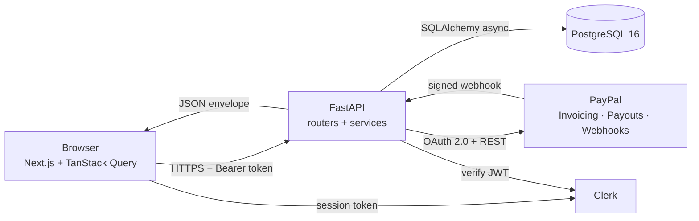

# Part 3 — Architecture

> [Handbook index](../README.md) · **Part 3 of 9**

This part explains how the pieces fit together: the running components, one
request from browser to database, and the schema that holds the money.

## Chapters

1. [System overview](./system-overview.md) — components, boundaries and the
   planned additions.
2. [Request lifecycle](./request-lifecycle.md) — a single API call, step by
   step.
3. [Data model](./data-model.md) — tables, relationships and money rules.

## Architecture in one diagram

The design keeps three boundaries sharp:

| Boundary | Rule |
|----------|------|
| Browser ↔ API | The browser never meets PayPal or the database. Everything goes through one typed HTTP client |
| API ↔ PayPal | PayPal is the source of truth for money; local rows mirror it via webhooks |
| Human ↔ agent | The agent can write proposals, never execution calls |

Next: [System overview](./system-overview.md) →
