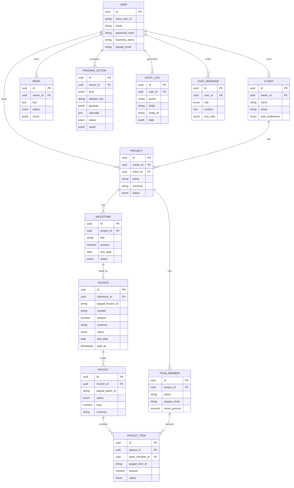
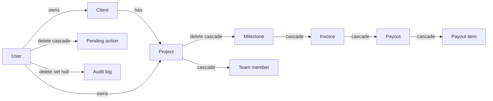

# Data model

> [Handbook index](../README.md) · [Part 3](./README.md) · **Status: Implemented**

All tables below exist in the database, and the invoice, payout, approval and
webhook **routes** are implemented. The UI on top is still being built.

## Entity relationships

`WEBHOOK_EVENT` stands alone, keyed by PayPal's event id:

| Column | Type | Purpose |
|--------|------|---------|
| `id` | string, primary key | PayPal event id; the dedupe key |
| `event_type` | string, indexed | For example `INVOICING.INVOICE.PAID` |
| `payload` | JSONB | Raw verified event |
| `processed_at` | timestamp | Set after handling; null means pending |
| `created_at` | timestamp | Receipt time |

## Enumerations

| Enum | Values |
|------|--------|
| `TonePreference` | `friendly`, `formal`, `firm` |
| `ProjectStatus` | `active`, `completed`, `archived` |
| `MilestoneStatus` | `todo`, `done`, `billed` |
| `InvoiceStatus` | `draft`, `sent`, `paid`, `partially_paid`, `cancelled`, `refunded` |
| `PayoutStatus` / `PayoutItemStatus` | `pending`, `success`, `denied`, `unclaimed`, `failed` |
| `ActionStatus` | `pending`, `executed`, `failed`, `rejected`, `expired` |
| `ActionKind` | `create_invoice`, `send_invoice`, `send_reminder`, `cancel_invoice`, `prepare_payout`, `execute_payout`, `draft_dispute_response` |
| `BriefStatus` | `pending`, `ready`, `failed` |
| `ChatRole` | `user`, `assistant`, `system`, `tool` |

Enums are persisted by **value** (lowercase), not member name, so the database
reads naturally and survives Python renames.

## Money rules

| Rule | Implementation |
|------|----------------|
| No floats | `Numeric(12, 2)` in the database, `Decimal` in Python |
| One currency per project | `projects.currency`; invoices and payouts copy it |
| Positive amounts | Milestone `amount > 0` at the schema boundary |
| Splits bounded | Team shares are `> 0` and never exceed 100% in total |
| Deterministic rounding *(planned)* | Largest-remainder allocation, so items always sum to the invoice total |

The split algorithm is not written yet. When it is, it will live in
`services/payouts.py` and be tested with amounts such as `100.00` split three
ways — the case where naive rounding loses a cent.

## Ownership and cascades

Deleting an agency removes its business data but **keeps audit rows** with a
null user id. An audit trail that disappears with its author is not an audit
trail.

## Indexes

- Every owner foreign key is indexed (`users` scoping).
- `clients.email`, `users.email`, `users.clerk_user_id` are indexed; emails and
  Clerk ids are unique.
- `pending_actions.dedupe_key` is unique, which is what makes retries safe.
- `pending_actions.status` and `webhook_events.event_type` are indexed for
  queues and handlers.
- `audit_log.entity` + `entity_id` are indexed for "what happened to this
  invoice?" queries.

## Migrations

Four migrations exist:

| Revision | Change |
|----------|--------|
| `281c60b543e0` | Initial schema: all tables |
| `77a59e157cd9` | Add `users.clerk_user_id` |
| `a1dc76bf447b` | Make `users.business_name` nullable |
| `c3f1a9d2b7e4` | Add `payout_items.paypal_item_id` |

Never edit an applied migration. Add a new one (`alembic revision
--autogenerate -m "…"`) and review the generated file before committing.

Next: [API conventions](../04-backend/api-conventions.md) →
