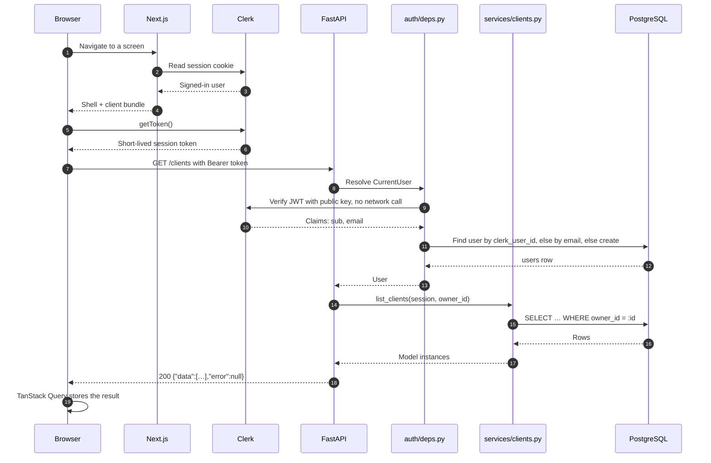
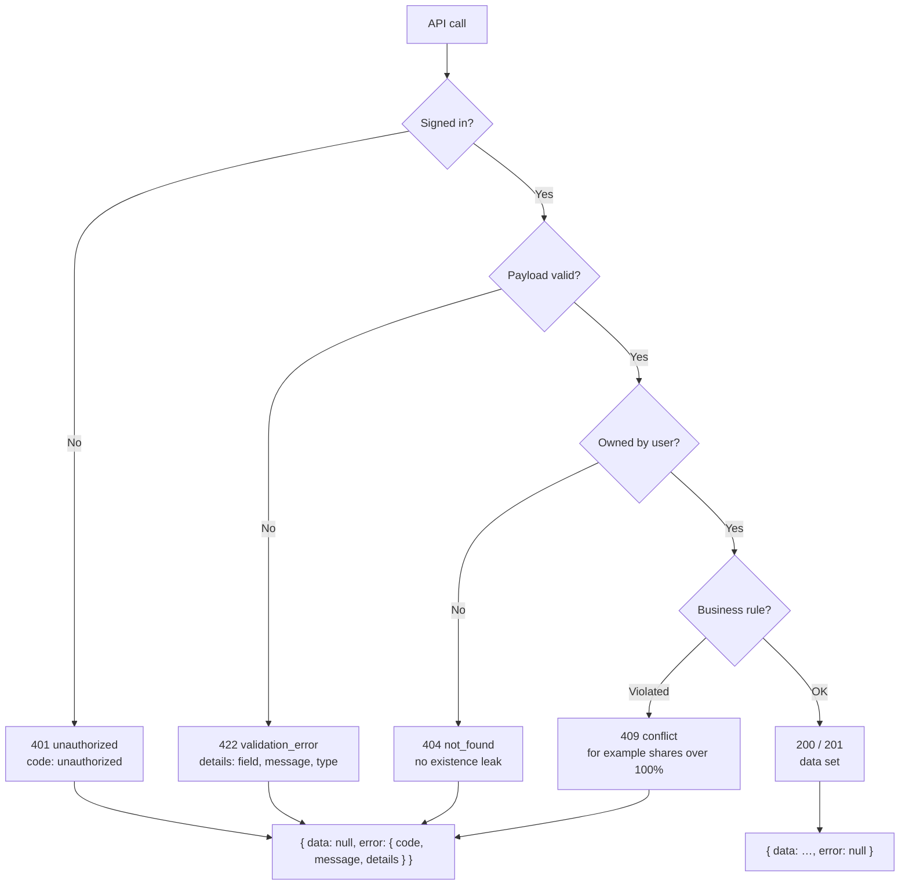
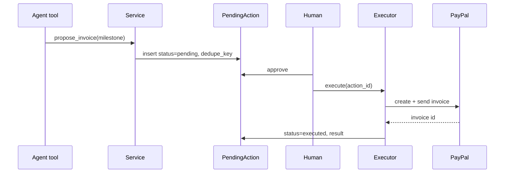

# Request lifecycle

> [Handbook index](../README.md) · [Part 3](./README.md) · **Status: Implemented**

One authenticated API call, from click to JSON. The example lists clients.

## Happy path

### What each step guarantees

| Step | Guarantee |
|------|-----------|
| Clerk session | Identity is never trusted from the browser alone |
| Local JWT verification | No per-request call to Clerk; the public key is enough |
| Owner-scoped query | A user cannot read another user's rows, even with a guessed UUID |
| Envelope | The client never branches on raw JSON shape |
| Query cache | A second screen reuses fresh data for 30 seconds |

## Failure path

Every failure uses the same envelope and the HTTP status carries the truth.
The frontend turns `error` into a typed `ApiError` once, in
`frontend/lib/api/client.ts`.

## Why ownership returns 404, not 403

A guessed UUID returns `404 not_found` rather than `403 forbidden`. Returning
403 would confirm that the row exists, which leaks information across
workspaces. `403` is reserved for a real permission problem on a resource the
caller can already see (planned roles).

## Where the agent will plug in

The agent will call the **same services**, not the routers, and its write paths
will end in a `PendingAction` instead of a PayPal call:

The agent never receives the executor dependency. That is enforced by
construction, not by prompt instructions.

Next: [Data model](./data-model.md) →
