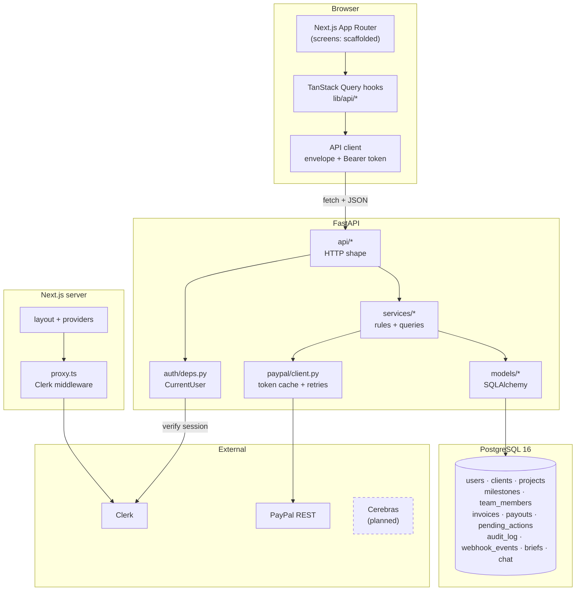
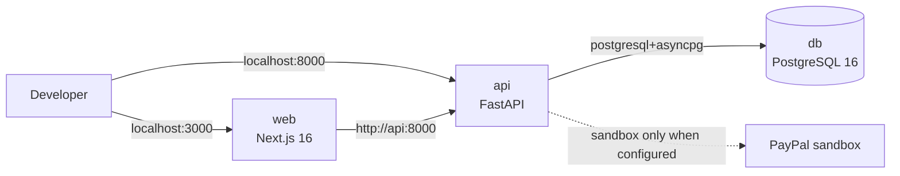

# System overview

> [Handbook index](../README.md) · [Part 3](./README.md) · **Status: Implemented (core), Planned (agent and billing routes)**

## Components

## Responsibilities

| Component | Owns | Must never |
|-----------|------|------------|
| Next.js | Rendering, routing, session UI, optimistic cache | Talk to PayPal or Postgres directly |
| FastAPI routers | HTTP status, validation, dependency wiring | Contain money rules |
| Services | Ownership checks, transactions, split maths | Know about HTTP |
| Models | Schema and relationships | Call external services |
| PayPal client | OAuth, retries, idempotency, error translation | Decide whether an action is approved |
| Approval executor *(planned)* | Execute only approved proposals | Be callable by the agent |
| Clerk | Sessions and identity | Store agency business data |

## Runtime topology (local)

## Planned additions

The architecture is designed so these can be added without moving boundaries:

| Addition | Where it plugs in | Status |
|----------|-------------------|--------|
| Invoice and payout routes | `api/invoices.py`, `api/payouts.py` → existing services | Planned |
| Approval queue and executor | `api/actions.py`, `services/executor.py` → `pending_actions` | Planned |
| Webhook receiver | `api/webhooks.py` → `webhook_events`, signature verifier | Planned |
| LLM client and tools | `app/ai/` → proposals only | Planned |
| Render Workflows | `workflows/` → same services | Planned |
| AG Studio dashboard | `components/studio/` behind a flag | Planned |

## Why this shape

- **One API, two clients.** The browser and (later) the MCP server use the same
  routes, so the safety rules cannot be bypassed by a second entry point.
- **Postgres is the queue.** `pending_actions` is a table, not an in-memory
  queue, so a crash cannot lose a proposal or approve one twice.
- **PayPal is the ledger of record.** Local invoice and payout rows mirror it;
  webhooks reconcile drift.
- **Modes, not branches.** Dev, mock and sandbox are selected at startup, not
  scattered through request code.

Next: [Request lifecycle](./request-lifecycle.md) →
