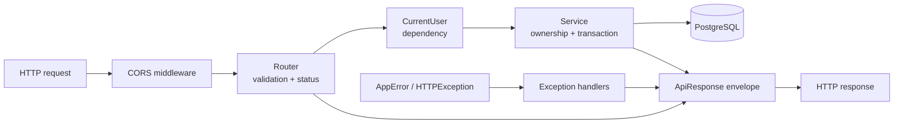

# Part 4 — Backend

> [Handbook index](../README.md) · **Part 4 of 9**

The backend is a FastAPI application split into thin routers, testable services
and explicit SQLAlchemy models. This part documents the conventions, the auth
model, the domain routes that exist, the database, the PayPal transport and the
test suite.

## Chapters

1. [API conventions](./api-conventions.md) — one envelope, one error shape.
2. [Authentication](./authentication.md) — Clerk, dev mode, ownership.
3. [Domain API](./domain-api.md) — clients, projects, milestones, team.
4. [Database](./database.md) — models, migrations, seeding.
5. [PayPal client](./paypal-client.md) — OAuth, retries, idempotency, mock.
6. [Testing](./testing.md) — fixtures, coverage, patterns.

## Request pipeline



## Layout

```text
backend/app/
├── main.py        app factory, lifespan, router registration
├── core/          config.py, errors.py
├── db/            base.py (metadata, naming), session.py
├── models/        one module per aggregate + enums
├── schemas/       request/response models + envelope
├── services/      queries, ownership checks, transactions
├── api/           routers only
├── auth/          Clerk verification, deps, provisioning
├── paypal/        client, errors, mock, deps
└── scripts/       demo fixture + seed
```

Next: [API conventions](./api-conventions.md) →
