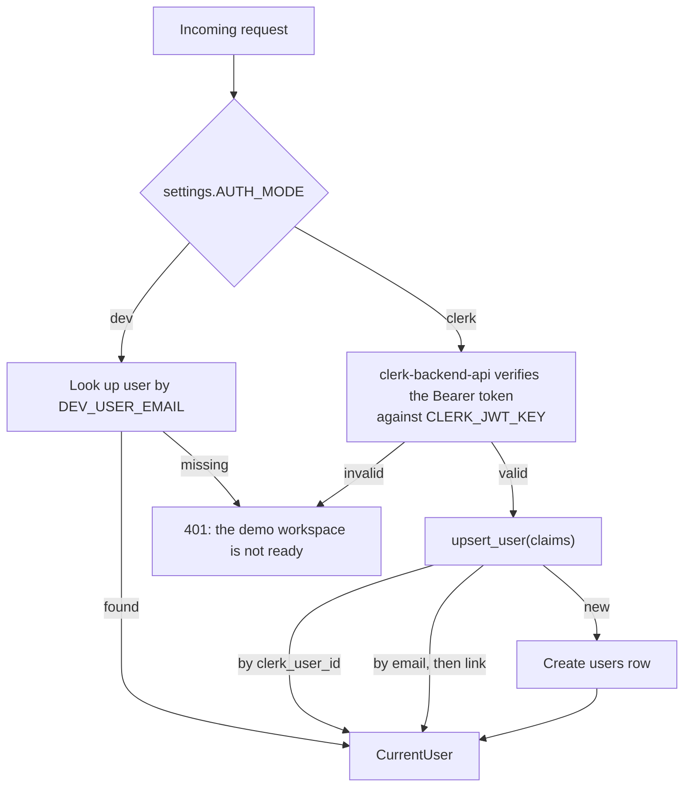
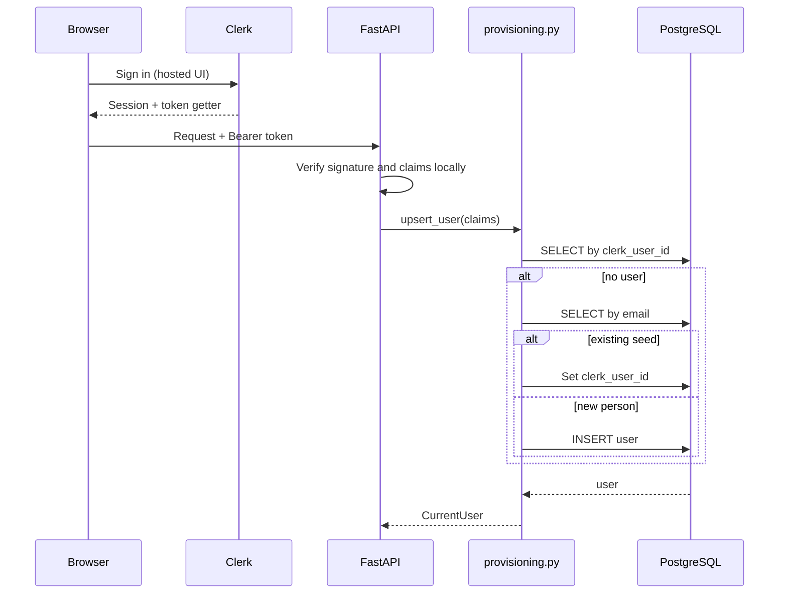

# Authentication

> [Handbook index](../README.md) · [Part 4](./README.md) · **Status: Implemented**

Vizlify uses **Clerk** for identity and keeps a local `users` row for ownership.
There are two modes: `clerk` for hosted runs and `dev` for local runs and
judges. `dev` is refused in production.

## The two modes



## Clerk mode

Frontend:

1. `ClerkProvider` wraps the app in `app/layout.tsx`.
2. `proxy.ts` runs Clerk middleware for session handling.
3. `ApiProvider` calls `useAuth().getToken()` before each request and attaches
   the token as `Authorization: Bearer …`.

Backend:

1. `auth/clerk.py` calls `authenticate_request_async` with
   `CLERK_SECRET_KEY`, `CLERK_JWT_KEY` and `CLERK_AUTHORIZED_PARTIES`.
2. Verification is **networkless**: the JWT is checked against the public key,
   so there is no per-request round trip to Clerk.
3. `auth/provisioning.py` maps the Clerk subject to a local user:
   - first by `clerk_user_id`;
   - then by email, linking an existing seeded user;
   - otherwise creating a user with `email` and optional `business_name`.
4. `auth/deps.py` exposes `CurrentUser`, an `Annotated[User, Depends(...)]`.



Required backend variables:

```env
AUTH_MODE=clerk
CLERK_SECRET_KEY=sk_test_...
CLERK_JWT_KEY=-----BEGIN PUBLIC KEY-----...
CLERK_AUTHORIZED_PARTIES=http://localhost:3000,https://vizlify.space
```

## Dev mode

```env
AUTH_MODE=dev
DEV_USER_EMAIL=demo@vizlify.space
```

`get_current_user` looks up the seeded user by email and returns it. No token is
needed. The frontend still renders Clerk's provider; the token is simply
ignored by the backend.

Fail-closed rules:

- `AUTH_MODE=dev` is refused when `APP_ENV=production`;
- `DEV_USER_EMAIL` is required in dev mode;
- a missing seeded user produces a clear `401`, not a crash.

## Ownership model

Every business table has an owner path to `users`:

**Implemented**

- `clients.owner_id`
- `projects.owner_id` (also `client_id`)
- `milestones` → `projects.owner_id`
- `team_members` → `projects.owner_id`

Services always filter by owner and return `404` when a row is not owned. The
test suites cover cross-owner reads and writes for each resource.

**Planned**

- Roles (`owner`, `admin`, `member`) and a freelancer view that only exposes
  their payout items.
- An invite flow.

## What is not stored

- No passwords: `users.password_hash` exists for historical reasons but is
  unused and nullable.
- No Clerk secrets in the database.
- No session tokens in logs.

## Security notes

- `CLERK_SECRET_KEY` and `PAYPAL_CLIENT_SECRET` must never be exposed with a
  `NEXT_PUBLIC_` prefix.
- `CLERK_AUTHORIZED_PARTIES` must list the exact frontend origins; a wildcard
  defeats the point.
- In dev mode, anyone who can reach the API is the demo user. **Never expose a
  dev-mode deployment publicly.**

Next: [Domain API](./domain-api.md) →
