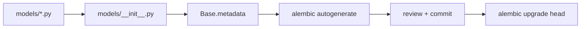

# Database

> [Handbook index](../README.md) · [Part 4](./README.md) · **Status: Implemented**

PostgreSQL 16 in every environment that matters; SQLite in memory for tests.
SQLAlchemy 2.1 async with `asyncpg` in production and `aiosqlite` in tests.

## Connection

```python
# app/db/session.py
engine = create_async_engine(str(settings.DATABASE_URL), pool_pre_ping=True)
SessionFactory = async_sessionmaker(engine, expire_on_commit=False)


async def get_db() -> AsyncIterator[AsyncSession]:
    async with SessionFactory() as session:
        yield session
```

Routers receive the session through `SessionDep`; they never build their own.
`expire_on_commit=False` keeps loaded attributes usable after a commit, which
matters because services return models straight to Pydantic.

## Base and naming

```python
# app/db/base.py
class Base(DeclarativeBase):
    metadata = MetaData(naming_convention=NAMING_CONVENTION)
```

The naming convention makes generated constraint names stable across
autogenerate runs: `invoices_pkey`, `projects_owner_id_fkey`,
`clients_email_key`. Without it, Alembic produces noisy, environment-specific
migrations.

Two helpers keep Postgres and SQLite in agreement:

| Helper | On Postgres | On SQLite (tests) |
|--------|-------------|-------------------|
| `JsonB` | `JSONB` | `JSON` |
| `sql_enum(Enum)` | native enum, **by value** | `VARCHAR` + check |

`sql_enum` persists lowercase values (`"friendly"`), not member names, so the
database and the API speak the same language.

## Migrations

```bash
cd backend

uv run alembic upgrade head                        # apply
uv run alembic revision --autogenerate -m "change" # create
uv run alembic downgrade -1                        # one step back
uv run alembic history                             # list
```

Rules:

1. **Never edit an applied migration.** Add a new revision.
2. **Read the autogenerated file.** Autogenerate misses server defaults, data
   migrations and enum changes.
3. **Test both directions** when a change is destructive.
4. **One concern per revision**, named in the imperative (`add_clerk_user_id`).

Existing revisions:

| Revision | Change |
|----------|--------|
| `281c60b543e0` | Initial schema |
| `77a59e157cd9` | `users.clerk_user_id` |
| `a1dc76bf447b` | `users.business_name` nullable |

## Seeding

```bash
docker compose exec api python -m app.scripts.seed
# or, outside Docker:
cd backend && uv run python -m app.scripts.seed
```

The seed is idempotent: it looks for `DEV_USER_EMAIL` and does nothing if the
agency exists. Data lives in `app/scripts/demo_agency.json` and is validated by
Pydantic before it touches the database.

Seed contents:

- Northwind Studio (business name and PayPal email);
- Acme Co (friendly) and Globex Corporation (formal);
- Acme website redesign, USD, three milestones: $2,500 / $4,000 / $6,000;
- three freelancers at 40% / 35% / 25%.

To reset: `docker compose down -v` then start and seed again.

## Adding a model

1. Write the model in `app/models/<aggregate>.py`, using `TimestampMixin`,
   `Mapped[...]`, and `sql_enum` for enums.
2. Export it from `app/models/__init__.py` so metadata and autogenerate see it.
3. Add the Pydantic schemas in `app/schemas/`.
4. Add the service in `app/services/` with ownership checks.
5. Add the router in `app/api/` and register it in `app/main.py`.
6. Generate and review the migration.
7. Add tests: create, read, update, delete, validation, cross-owner.



## Transactions

Services commit explicitly. A service method should leave the session in a
consistent state on success and let exceptions propagate:

```python
async def create_client(session, owner_id, data) -> Client:
    client = Client(owner_id=owner_id, **data.model_dump())
    session.add(client)
    await session.commit()
    await session.refresh(client)
    return client
```

Multi-step operations (invoice + proposal + audit row) must share one
transaction. That is why the executor will live in a service, not a router.

## Tests use SQLite, production uses Postgres

The test fixture creates all tables in an in-memory database per test:

```python
engine = create_async_engine("sqlite+aiosqlite:///:memory:")
async with engine.begin() as conn:
    await conn.run_sync(Base.metadata.create_all)
```

Consequences to remember:

- SQLite does not enforce `ON DELETE CASCADE` unless foreign keys are enabled,
  so ORM `cascade=` rules must be correct on their own.
- Native enums and JSONB behavior differ; keep both helpers in use.
- A migration can be valid on Postgres and untested on SQLite. Run the stack
  against Postgres before shipping schema changes.

## Backup and reset

Local data is disposable. Production will use Render Postgres with automatic
backups (planned). The handbook never stores real financial data; the sandbox
is the only source of money events.

Next: [PayPal client](./paypal-client.md) →
