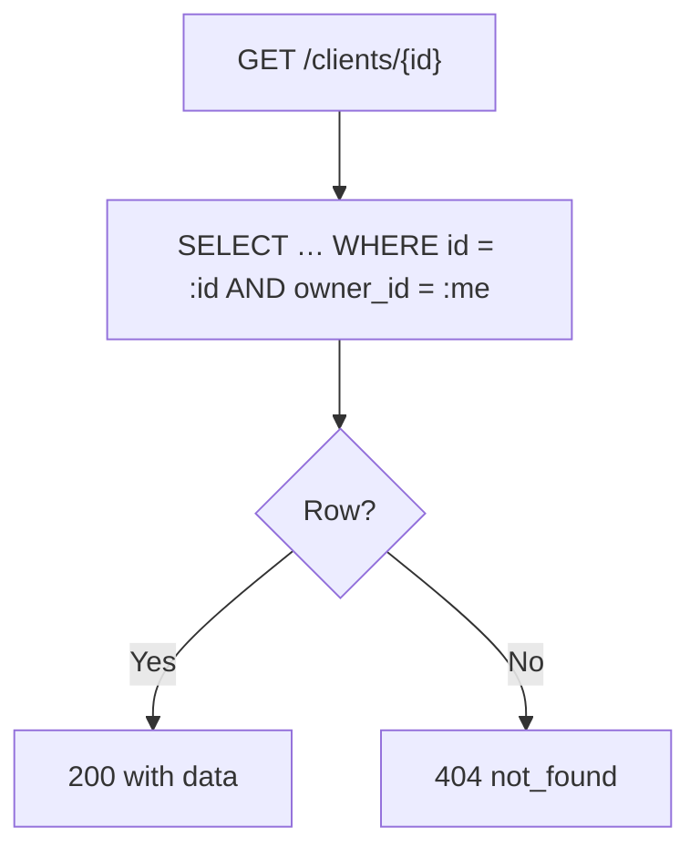

# Domain API

> [Handbook index](../README.md) · [Part 4](./README.md) · **Status: Implemented**

The routes that exist today cover the agency's people and work: account,
clients, projects, milestones and team members. Invoices, payouts and approvals
have tables but no routes yet.

All routes require authentication and are owner-scoped. IDs are UUIDs.

## Account

| Method | Path | Returns |
|--------|------|---------|
| `GET` | `/me` | The current user |

```json
{
  "data": {
    "id": "…",
    "email": "demo@vizlify.space",
    "business_name": "Northwind Studio",
    "paypal_email": "northwind-facilitator@business.example"
  },
  "error": null
}
```

## Clients

| Method | Path | Body | Status |
|--------|------|------|--------|
| `GET` | `/clients` | — | 200 |
| `POST` | `/clients` | `name`, `email`, `tone_preference?` | 201 |
| `GET` | `/clients/{id}` | — | 200 |
| `PATCH` | `/clients/{id}` | any of the create fields | 200 |
| `DELETE` | `/clients/{id}` | — | 200 |

`tone_preference` is `friendly`, `formal` or `firm` and defaults to `friendly`.
It is stored now so the reminder agent can use it later.

```bash
curl -X POST http://localhost:8000/clients \
  -H 'Content-Type: application/json' \
  -d '{"name":"Initech","email":"billing@initech.dev","tone_preference":"formal"}'
```

**Deleting a client deletes its projects**, and each project's milestones and
team members. The cascade is enforced in the ORM and mirrored by
`ON DELETE CASCADE` in Postgres.

## Projects

| Method | Path | Body | Status |
|--------|------|------|--------|
| `GET` | `/projects` | — | 200 |
| `POST` | `/projects` | `client_id`, `name`, `currency`, `status?` | 201 |
| `GET` | `/projects/{id}` | — | 200 |
| `PATCH` | `/projects/{id}` | `name`, `currency`, `status` | 200 |
| `DELETE` | `/projects/{id}` | — | 200 |

- `currency` is a three-letter code (`USD`, `EUR`, …). One currency per project.
- `status` is `active`, `completed` or `archived`, default `active`.
- The client must exist and belong to the caller, otherwise `404`.

Deleting a project cascades milestones and team members. Invoices are not
handled yet; before invoices can exist, deletion needs an explicit policy
(cascade or block) so financial history is never silently destroyed.

## Milestones

| Method | Path | Body | Status |
|--------|------|------|--------|
| `GET` | `/projects/{project_id}/milestones` | — | 200 |
| `POST` | `/projects/{project_id}/milestones` | `title`, `amount`, `due_date?`, `status?` | 201 |
| `GET` | `/milestones/{id}` | — | 200 |
| `PATCH` | `/milestones/{id}` | any create field | 200 |
| `DELETE` | `/milestones/{id}` | — | 200 |

- `amount` must be greater than zero, with at most two decimals.
- `due_date` is an ISO date or `null`.
- `status` is `todo`, `done` or `billed`, default `todo`.

Marking a milestone `done` will eventually create an invoice proposal. Today it
only changes the status.

```json
{
  "title": "Discovery & wireframes",
  "amount": "2500.00",
  "due_date": "2026-11-03"
}
```

## Team members

| Method | Path | Body | Status |
|--------|------|------|--------|
| `GET` | `/projects/{project_id}/team` | — | 200 |
| `POST` | `/projects/{project_id}/team` | `name`, `paypal_email`, `share_percent` | 201 |
| `PATCH` | `/team/{id}` | any create field | 200 |
| `DELETE` | `/team/{id}` | — | 200 |

- `share_percent` is a decimal string between 0 and 100.
- The **sum of shares for a project can never exceed 100**. Creating or updating
  past the limit returns `409 conflict`.
- A project may have fewer than 100% allocated; the remainder is the agency's.

```bash
curl -X POST http://localhost:8000/projects/$PROJECT/team \
  -H 'Content-Type: application/json' \
  -d '{"name":"Maya Patel","paypal_email":"maya@example.com","share_percent":"35.00"}'
```

## Ownership and not-found behavior



Cross-owner access is indistinguishable from a missing row. Tests create a
second user and assert their rows never appear.

## Money routes

The money loop is implemented on top of these domain routes:

- [`/actions`](../08-reference/api-endpoints.md#approvals) — the approval queue and executor
- [`/invoices`](../08-reference/api-endpoints.md#invoices) — create/send, remind, cancel, refresh
- [`/payouts`](../08-reference/api-endpoints.md#payouts) — split preparation and batch execution
- [`/webhooks/paypal`](../08-reference/api-endpoints.md#webhooks) — verified, deduped events

See [API endpoints](../08-reference/api-endpoints.md) for the complete route
inventory.

## What is missing

| Missing route group | Depends on |
|---------------------|------------|
| `/briefs`, `/chat` | LLM client |
| `/analytics` | Dashboard widgets |
| `/demo/time-travel`, `/demo/reset` | Demo controls |

Next: [Database](./database.md) →

Next: [Database](./database.md) →
