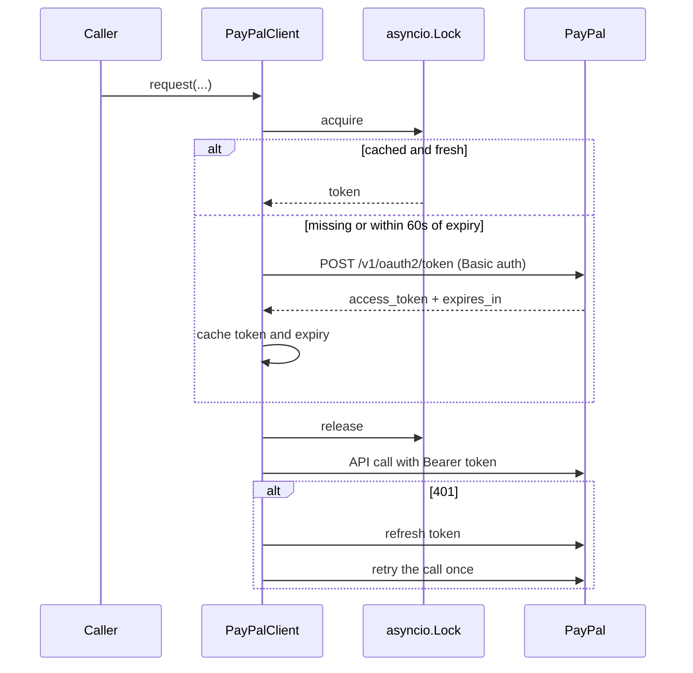
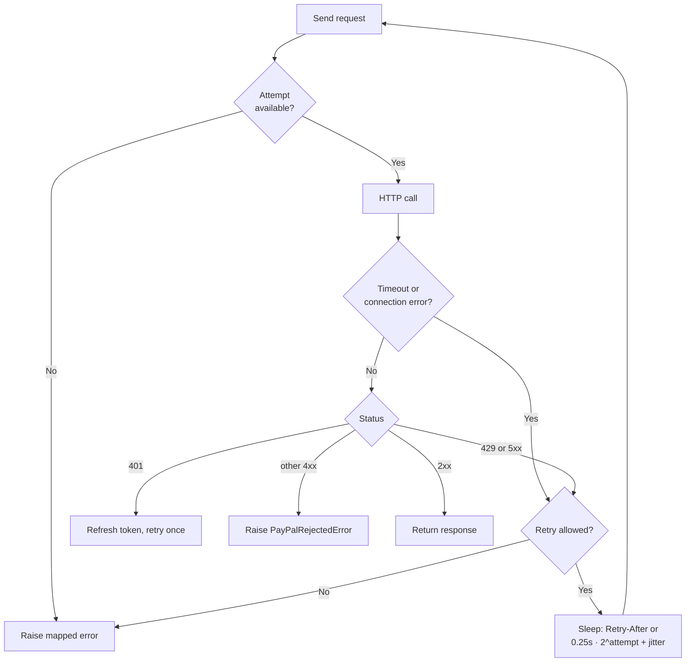

# PayPal client

> [Handbook index](../README.md) · [Part 4](./README.md) · **Status: Implemented (transport), Planned (invoice and payout routes)**

Vizlify talks to PayPal through a small async HTTP client in
`backend/app/paypal/`. It deliberately does not use a generated server SDK: the
official Python SDK is synchronous, which fights an async FastAPI app and is
awkward to mock. See
[ADR-0001](../07-decisions/adr-0001-thin-paypal-client.md).

## Files

| File | Responsibility |
|------|----------------|
| `client.py` | OAuth token cache, retries, idempotency, response wrapper |
| `errors.py` | PayPal failures mapped to the API envelope |
| `mock.py` | In-process transport used when `PAYPAL_MODE=mock` |
| `deps.py` | FastAPI dependency exposing the process-wide client |

## Modes

| Mode | Transport | Keys | Allowed in production |
|------|-----------|------|-----------------------|
| `mock` (default) | `httpx.MockTransport` | none | no |
| `sandbox` | `https://api-m.sandbox.paypal.com` | id + secret | yes |
| `live` | `https://api-m.paypal.com` | id + secret | only |

The base URL is derived from the mode, so a typo cannot point live mode at the
sandbox. `live` is refused outside production to make an accidental real-money
run impossible.

```env
PAYPAL_MODE=mock
PAYPAL_CLIENT_ID=
PAYPAL_CLIENT_SECRET=
PAYPAL_WEBHOOK_ID=
PAYPAL_TIMEOUT_SECONDS=15
PAYPAL_MAX_RETRIES=2
```

## OAuth token cache



- One token per process, shared by every request.
- The lock makes the first burst of concurrent requests perform **one** token
  fetch.
- Refresh happens 60 seconds before `expires_in`.
- A 401 invalidates the token, fetches a new one and retries **once**. A second
  401 becomes `PayPalAuthError`.

## Retry policy



Rules, taken from PayPal's
[error guide](https://developer.paypal.com/invoicing/errors):

- retry `429`, `408` and `5xx` with exponential backoff and jitter;
- honour `Retry-After`, capped at 30 seconds;
- never retry other `4xx`;
- retry timeouts and connection errors;
- **retry a write only if it carries a `PayPal-Request-Id`**, because otherwise
  a retry can duplicate a financial action.

The number of attempts is `PAYPAL_MAX_RETRIES + 1` for retryable requests and
exactly 1 for unsafe writes.

## Idempotency

```python
from app.paypal import new_request_id

request_id = new_request_id("invoice", milestone.id)  # deterministic, <= 38 chars
```

`new_request_id` hashes the logical action (kind plus identifiers) to a
7-character slug and 30 hex characters. Two calls for the same milestone
produce the same key; a retried workflow re-run therefore returns the original
PayPal resource instead of creating a duplicate.

The header is set once and reused for every retry attempt:

```http
PayPal-Request-Id: invoice-3f9c0a1d2e4b5c6d7e8f90123a4b5c
```

Payouts have a second dedupe layer: a unique `sender_batch_id` per batch, which
PayPal retains for 30 days.

## Errors

| PayPal | Exception | HTTP to the browser | Message |
|--------|-----------|---------------------|---------|
| 401 | `PayPalAuthError` | 502 | PayPal rejected the API credentials. |
| 403 | `PayPalAuthError` | 502 | PayPal denied this request; check enabled features. |
| 429 | `PayPalRateLimited` | 502 | PayPal is rate limiting requests. |
| 5xx | `PayPalUnavailable` | 502 | PayPal is temporarily unavailable. |
| other 4xx | `PayPalRejectedError` | 502 | PayPal rejected the request. |

The envelope adds PayPal's stable error name and `debug_id`:

```json
{
  "data": null,
  "error": {
    "code": "integration_error",
    "message": "PayPal rejected the request.",
    "details": [
      { "field": "paypal_error", "message": "UNPROCESSABLE_ENTITY" },
      { "field": "debug_id", "message": "abc123def456" }
    ]
  }
}
```

The raw PayPal body is logged, never returned, because it can echo request data.
`debug_id` is the value PayPal support asks for first.

## Using the client

```python
from app.paypal import new_request_id

eyJ = await paypal.post(
    "/v2/invoicing/invoices",
    json={
        "detail": {"currency_code": "USD", "invoice_number": "VIZ-0001"},
        "invoicer": {"email_address": agency.paypal_email},
        "primary_recipients": [
            {"billing_info": {"email_address": client.email}}
        ],
        "items": [
            {
                "name": milestone.title,
                "quantity": "1",
                "unit_amount": {"currency_code": "USD", "value": str(milestone.amount)},
            }
        ],
    },
    request_id=new_request_id("invoice", milestone.id),
)
invoice_id = eyJ.payload["id"]

await paypal.post(
    f"/v2/invoicing/invoices/{invoice_id}/send",
    request_id=new_request_id("invoice-send", milestone.id),
)
```

The 201 response carries a `Location` header; `PayPalResponse.header("Location")`
reads it. A `204` from `/send` returns `payload=None`, which is expected.

## Mock mode

`app/paypal/mock.py` is an `httpx.MockTransport`, not a fake service. The real
client still performs OAuth, header construction and parsing; only the last hop
is faked. This keeps the tests meaningful and makes switching to sandbox a
one-variable change.

Supported routes:

| Route | Behavior |
|-------|----------|
| `POST /v1/oauth2/token` | Returns `mock-access-token` |
| `POST /v2/invoicing/generate-next-invoice-number` | `VIZ-0001`, `VIZ-0002`, … |
| `POST /v2/invoicing/invoices` | `MOCK-INV-0001`, dedupes on `PayPal-Request-Id` |
| `POST /v2/invoicing/invoices/{id}/send|remind|cancel` | `204` |
| `POST /v1/payments/payouts` | `MOCK-BATCH-0001` |
| `POST /v1/notifications/verify-webhook-signature` | `SUCCESS` |
| anything else | `404 MOCK_ROUTE_NOT_IMPLEMENTED` |

Unknown routes fail loudly instead of pretending to work. When a new endpoint
is added, its mock must be added in the same pull request.

## Sandbox setup

1. Create a PayPal Developer account, then **Apps & Credentials → Sandbox**.
2. Create an app and copy the Client ID and Secret.
3. Enable **Invoicing** and **Payouts** on the app and fund the business
   balance; Payouts fails without funds.
4. Use the default sandbox **Business** account as the agency and **Personal**
   accounts as client and freelancers.
5. Add a webhook URL and copy the **Webhook ID** into `PAYPAL_WEBHOOK_ID`.
   Webhooks cannot reach `localhost`; use
   `cloudflared tunnel --url http://localhost:8000`.
6. Set `PAYPAL_MODE=sandbox` and restart the API.

## Testing

```bash
cd backend && uv run pytest tests/test_paypal_client.py
```

The suite injects a `MockTransport`, a fake clock and a sleep recorder, so
token expiry, 429 backoff and 5xx exhaustion tests run in milliseconds without
sleeping or touching the network. Coverage of `client.py` is 97%.

## APIMatic evidence

The hackathon asks for the APIMatic **PayPal Context Plugin** to be used for
every integration step, with evidence. This client was written against PayPal's
public docs (`developer.paypal.com/llms.txt`; append `.md` to any page for clean
text). The plugin is not available in this environment, so `docs/apimatic.md`
should record which prompts were used, what matched, and what differed when the
plugin is used in an editor that supports it.

Next: [Testing](./testing.md) →
