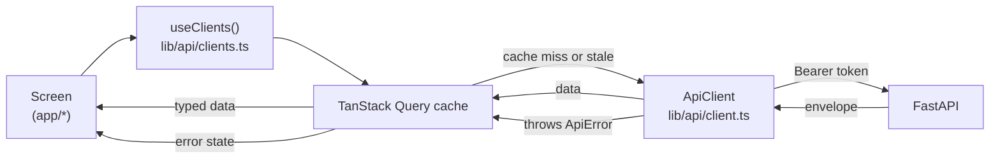

# Part 5 — Frontend

> [Handbook index](../README.md) · **Part 5 of 9**

The frontend is a Next.js 16 App Router application. The shell, providers,
API client and query layer are implemented. The screens are the next milestone.

## Chapters

1. [App shell](./app-shell.md) — layout, providers and the Clerk boundary.
2. [API client](./api-client.md) — the single HTTP entry point.
3. [Server state](./server-state.md) — TanStack Query keys, mutations and
   optimistic updates.
4. [Design system](./design-system.md) — shadcn/ui, Tailwind v4 and theming.

## Data flow

Three rules:

1. Components never call `fetch`; they call hooks.
2. Hooks never know the response envelope; the client unwraps it.
3. UI state (open dialogs, drafts) lives in React state, not in Query.

Next: [App shell](./app-shell.md) →
