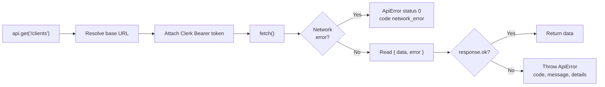

# API client

> [Handbook index](../README.md) · [Part 5](./README.md) · **Status: Implemented**

`frontend/lib/api/client.ts` is the only place that speaks HTTP to the backend.
Everything else calls typed methods on it.

## Responsibilities



## Creating a client

```ts
const api = createApiClient({
  baseUrl: process.env.NEXT_PUBLIC_API_URL,
  getToken: () => getToken(),
})
```

`ApiProvider` memoises this per session and exposes `useApiClient()`. Hooks use
that; components should not.

## ApiError

| Property | Type | Meaning |
|----------|------|---------|
| `status` | number | HTTP status, or `0` when the request never arrived |
| `code` | string | Backend error code (`not_found`, `validation_error`, …) |
| `message` | string | Human-readable, safe to show |
| `details` | array | Field-level validation details |
| `fieldErrors` | `Record<string, string>` | Flattened `field → message` |
| `isNetwork` | boolean | `status === 0` |
| `isUnauthorized` | boolean | 401 or 403 |
| `isValidation` | boolean | 422 |

Example handling:

```tsx
const create = useCreateClient()

create.mutate(input, {
  onError: (error) => {
    if (error instanceof ApiError && error.isValidation) {
      setFieldErrors(error.fieldErrors)
      return
    }
    toast.error("Could not save the client.")
  },
})
```

## Money, dates and IDs

The client does not transform payloads. Types mirror the backend, with money as
a **string**:

```ts
export type Money = string

export interface Milestone {
  id: string
  project_id: string
  title: string
  amount: Money
  due_date: string | null
  status: MilestoneStatus
}
```

Display through `lib/format.ts`:

```ts
formatMoney("2500.00", "USD")  // "$2,500.00"
formatDate("2026-11-03")       // "Nov 3, 2026"
```

## Rules

1. **No direct `fetch`** outside this file.
2. **No envelope knowledge** outside this file.
3. **No silent failures**: every mutation surfaces `ApiError.message`, which
   the backend guarantees is safe to show.
4. **No retries here.** TanStack Query owns retries for reads; mutations do not
   retry.
5. **Abort signals** are passed through from Query so a stale request can be
   cancelled when a filter changes.

Next: [Server state](./server-state.md) →
