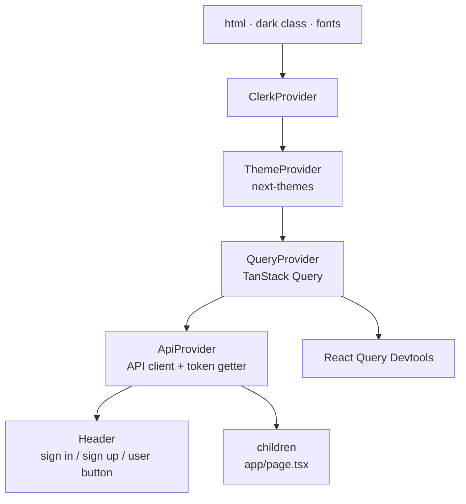
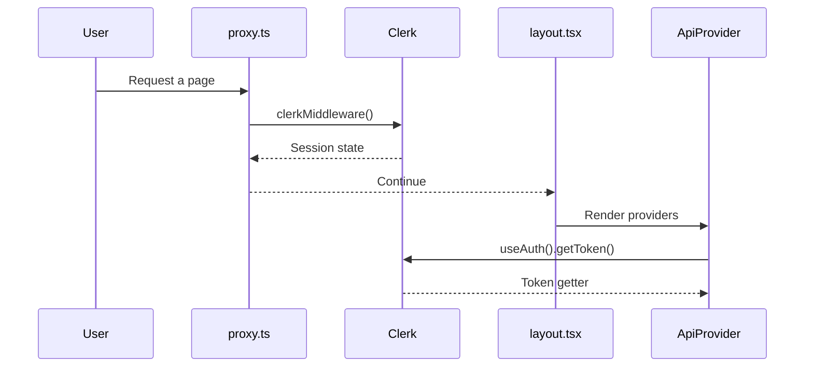

# App shell

> [Handbook index](../README.md) · [Part 5](./README.md) · **Status: Implemented (shell), Scaffolded (screens)**

## Provider stack

Order matters:

- **Clerk first**, because `ApiProvider` calls `useAuth()`.
- **Theme next**, so every component can read colour tokens.
- **Query after theme**, because devtools and errors render UI.
- **API client innermost**, so hooks have one client per session.

## Files

| File | Responsibility |
|------|----------------|
| `app/layout.tsx` | Metadata, fonts, provider stack, header |
| `app/page.tsx` | Starter screen (the real dashboard is planned) |
| `app/globals.css` | Tailwind v4 import, tokens, dark variant |
| `proxy.ts` | Clerk middleware and route matcher |
| `components/theme-provider.tsx` | System theme, persistence, `d` hotkey |
| `components/providers/query-provider.tsx` | One QueryClient per browser tab |
| `components/providers/api-provider.tsx` | Memoised API client with Clerk token |

## The Clerk boundary

`proxy.ts` matches everything except static assets, so static files never pay
for session handling. API and tRPC routes are matched too.

In `AUTH_MODE=dev` the token may be absent; the backend ignores it and resolves
the demo user. The frontend does not need a separate dev path.

## Fonts and theme

- **Inter** for UI (`--font-sans`), **Geist Mono** for code (`--font-mono`),
  loaded through `next/font/google` so there is no layout shift.
- `suppressHydrationWarning` on `<html>` because the theme class is applied
  before hydration.
- `disableTransitionOnChange` prevents a colour-transition flash when toggling
  dark mode.
- Pressing **`d`** toggles the theme, unless focus is in an input, textarea,
  select or content-editable element.

## What the shell does not have yet

- Real routes: `(auth)`, dashboard, clients, projects, invoices, approvals,
  chat.
- A sidebar or navigation.
- The sandbox banner ("no real money") required on every page.
- Error boundaries and a 404 page.

These are tracked in
[Project status](../09-project/status-and-roadmap.md). The shell was built
first so every screen inherits auth, theme and caching without repeating
setup.

Next: [API client](./api-client.md) →
