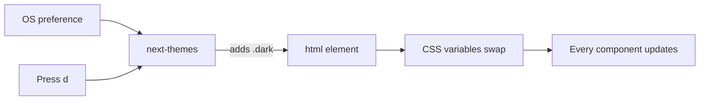

# Design system

> [Handbook index](../README.md) · [Part 5](./README.md) · **Status: Scaffolded**

Vizlify uses **shadcn/ui** components on **Tailwind CSS v4**, with **Base UI**
primitives underneath and **next-themes** for dark mode. Components are copied
into the repository, so they can be read, changed and reviewed like any other
code.

## Tokens

`app/globals.css` defines the theme with CSS variables in `oklch()` and maps
them into Tailwind with `@theme inline`:

```css
@import "tailwindcss";
@import "tw-animate-css";
@import "shadcn/tailwind.css";

@custom-variant dark (&:is(.dark *));

:root {
  --background: oklch(1 0 0);
  --foreground: oklch(0.145 0 0);
  --primary: oklch(0.841 0.238 128.85);
  --radius: 0.625rem;
}
```

| Group | Tokens |
|-------|--------|
| Surfaces | `background`, `card`, `popover`, `muted`, `accent`, `sidebar` |
| Text | `foreground`, `card-foreground`, `muted-foreground`, `primary-foreground` |
| Actions | `primary`, `secondary`, `destructive`, `ring` |
| Charts | `chart-1` … `chart-5` (green ramp) |
| Shape | `--radius` with `sm`–`4xl` derivatives |

Using tokens means dark mode is a variable swap, not a second stylesheet.

## Dark mode

- Class-based (`.dark`), default `system`.
- Persisted by `next-themes`.
- Toggle with the header control or the **`d`** hotkey.
- `disableTransitionOnChange` avoids a colour-flash.
- `suppressHydrationWarning` because the class is set pre-hydration.



## Components in the repo

| Component | File | Used for |
|-----------|------|----------|
| Button | `components/ui/button.tsx` | Actions, variants and sizes |
| Badge | `components/ui/badge.tsx` | Status, freshness, counts |
| Alert | `components/ui/alert.tsx` | Errors, warnings, notices |
| Empty | `components/ui/empty.tsx` | Empty lists and first-run states |
| Spinner | `components/ui/spinner.tsx` | Inline loading |
| DataState | `components/query/data-state.tsx` | Full query-state wrapper |

Add more with the shadcn CLI, which respects `components.json`:

```bash
cd frontend
bunx shadcn@latest add dialog table select
```

## Typography and shape

- **Inter** for interface text, **Geist Mono** for identifiers and code.
- Base radius `0.625rem`; cards and dialogs use `lg`, popovers `md`.
- Tailwind's default spacing scale; no arbitrary pixel values in feature code.
- Numbers that represent money use tabular figures where alignment matters.

## Accessibility rules

1. Every icon-only button has an `aria-label`.
2. Colour is never the only signal; badges pair colour with text.
3. Focus rings use `--ring`; never remove them without a replacement.
4. Dialogs and menus come from accessible primitives, not hand-rolled divs.
5. Loading states use `aria-live` where they replace content.
6. The sandbox banner (planned) must be readable by screen readers, not just
   decorative.

## Planned brand work

- A Money Board theme for AG Studio with the green ramp above.
- A sandbox banner and "no real money" badge on every page.
- Empty-state illustrations for clients, projects, invoices and approvals.
- A density switch for tables once the dashboard exists.

Until then, treat this page as the contract: new UI uses tokens, existing
components and the shared data states. A screen that hardcodes colours or
invents a spinner is a review failure.

Next: [Docker](../06-operations/docker.md) →
