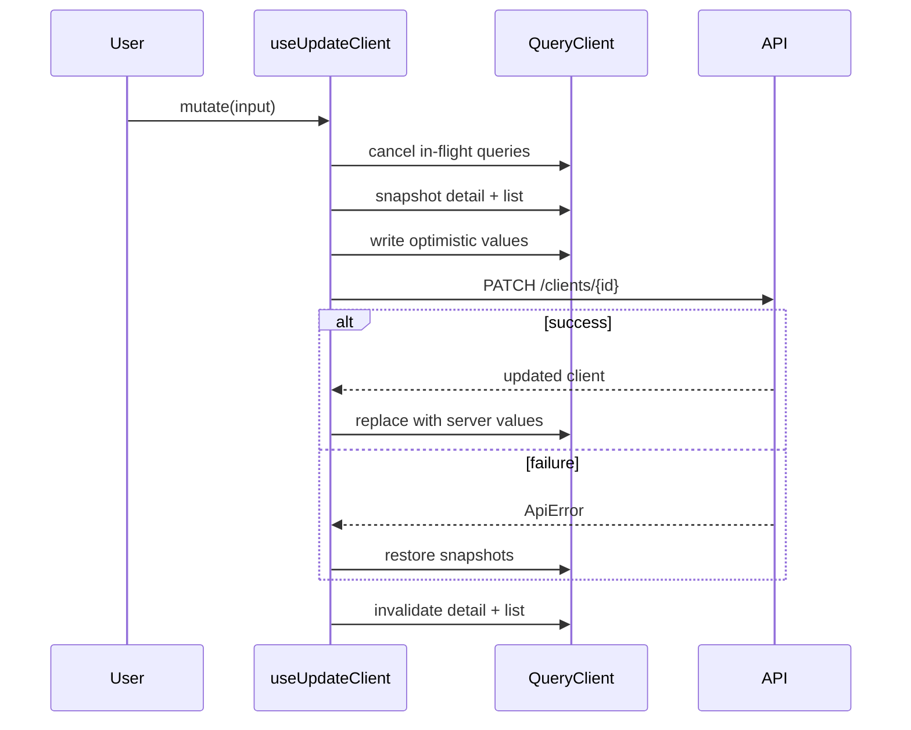

# Server state

> [Handbook index](../README.md) · [Part 5](./README.md) · **Status: Implemented**

All server data lives in **TanStack Query**. There is no global store for API
data, no manual cache and no duplicated server state in React context.

## Query keys

Each domain follows the same shape:

```ts
export const clientKeys = {
  all: ["clients"] as const,
  lists: () => [...clientKeys.all, "list"] as const,
  list: () => [...clientKeys.lists()] as const,
  details: () => [...clientKeys.all, "detail"] as const,
  detail: (id: string) => [...clientKeys.details(), id] as const,
}
```

| Domain | Key root | Hooks |
|--------|----------|-------|
| Account | `["account"]` | `useMe` |
| Clients | `["clients"]` | `useClients`, `useClient`, `useCreateClient`, `useUpdateClient`, `useDeleteClient` |
| Projects | `["projects"]` | `useProjects`, `useProject`, `useCreateProject`, `useUpdateProject`, `useDeleteProject` |
| Milestones | `["projects", id, "milestones"]` | `useMilestones`, `useMilestone`, `useCreateMilestone`, `useUpdateMilestone`, `useDeleteMilestone` |
| Team | `["projects", id, "team"]` | `useTeamMembers`, `useCreateTeamMember`, `useUpdateTeamMember`, `useDeleteTeamMember` |

The hierarchy is the invalidation tool: invalidating `["clients"]` refreshes
lists and details; invalidating `["projects", id]` refreshes that project's
milestones and team without touching other projects.

## Defaults

```ts
staleTime: 30_000          // fresh for 30 seconds
gcTime: 5 * 60_000         // keep unused data for 5 minutes
refetchOnWindowFocus: true
refetchOnReconnect: true
retry: (count, error) => {
  if (error.isUnauthorized || error.isValidation || error.status === 404) return false
  return count < 2
}
mutations: { retry: false }
```

- **Reads retry** twice on transient failures.
- **Auth, validation and missing-resource errors do not retry**; they will not
  fix themselves.
- **Mutations never retry automatically.** Money writes must be explicit, and
  the backend's PayPal layer already dedupes.

One `QueryClient` is created per browser tab and a fresh one per server render,
so data cannot leak between users during SSR.

## Optimistic updates

Updates and deletes write to the cache first, then reconcile. This makes the UI
feel instant without lying for long.



Every mutation invalidates on settle, even after success. The optimistic value
is a guess; the server is the truth.

## Shared state views

`components/query/data-state.tsx` provides one consistent treatment for every
screen:

| Component | Shows |
|-----------|-------|
| `QueryStatus` | Fresh / stale / refreshing / loading / cached badge |
| `UpdatedAt` | Last successful fetch time |
| `QueryError` | Error message plus retry button, network-aware |
| `StaleDataNotice` | Banner when showing cached data after a failed refetch |
| `QueryEmpty` | Empty state with icon, title, description and action |
| `DataState` | Composes all of the above around a query |

```tsx
<DataState query={clients} empty={{ title: "No clients yet" }}>
  {(data) => <ClientTable clients={data} />}
</DataState>
```

This is why screens should not hand-roll spinners or error text: consistency is
a component, not a convention.

## Adding a domain

1. Add types to `lib/api/types.ts`.
2. Add keys and `queryOptions` in `lib/api/<domain>.ts`.
3. Add query hooks and mutation hooks beside them.
4. Use `useApiClient()`; never import `fetch`.
5. Add optimistic updates only when the screen benefits; a create can simply
   invalidate.
6. Use `DataState` in the screen.
7. Invalidate the narrowest key that covers the change.

## Rules

- Server data is never copied into `useState`. Derive it during render.
- A mutation returns the updated entity; use it to seed the detail cache.
- `queryFn` always receives `{ signal }` and passes it to the API client.
- Query keys are arrays of primitives, serialisable and stable.
- Do not store tokens or user identity in Query.

Next: [Design system](./design-system.md) →
