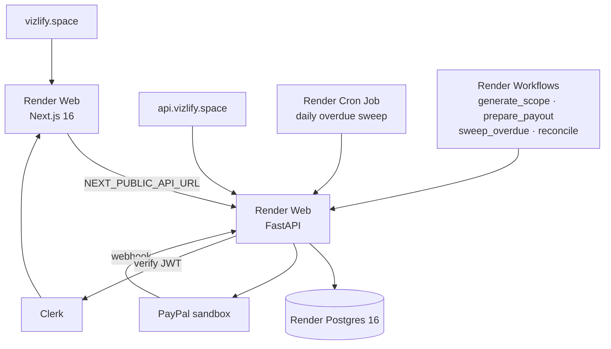

# Deployment

> [Handbook index](../README.md) · [Part 6](./README.md) · **Status: Planned**

Vizlify is not deployed yet. This page is the agreed target so the first deploy
is boring.

## Target topology



## Components

| Component | Render type | Notes |
|-----------|-------------|-------|
| `web` | Web Service (Docker) | Next.js; apex domain `vizlify.space` |
| `api` | Web Service (Docker) | FastAPI; `api.vizlify.space` |
| `db` | Postgres 16 | Paid tier recommended; free tier is time-limited |
| `cron` | Cron Job | Runs the daily overdue sweep |
| `workflows` | Workflow service | Long-running AI and payout preparation |
| `redis` | Key Value *(optional)* | Only if a shared queue is needed |

## Why `api.` on a subdomain

Auth uses a Bearer header, so cookies are not required for API calls. A
subdomain keeps the API independently deployable and lets the web service call
it without same-site cookie constraints. If a cookie-based session is added
later, the domain layout already supports it.

## Configuration

Use a Render **environment group** shared by `api` and `cron`:

```env
APP_ENV=production
SECRET_KEY=<generated>
DATABASE_URL=<from Render Postgres>
CORS_ORIGINS=https://vizlify.space
FRONTEND_URL=https://vizlify.space

AUTH_MODE=clerk
CLERK_SECRET_KEY=<secret>
CLERK_JWT_KEY=<PEM>
CLERK_AUTHORIZED_PARTIES=https://vizlify.space

PAYPAL_MODE=sandbox
PAYPAL_CLIENT_ID=<sandbox id>
PAYPAL_CLIENT_SECRET=<sandbox secret>
PAYPAL_WEBHOOK_ID=<webhook id>

LLM_MODE=mock
DEMO_MODE=true
JOBS_MODE=inline
```

Production refuses `AUTH_MODE=dev` and `PAYPAL_MODE=mock`, so a missing setting
fails the deploy instead of exposing a key-free app.

Frontend build arguments:

```env
NEXT_PUBLIC_API_URL=https://api.vizlify.space
NEXT_PUBLIC_CLERK_PUBLISHABLE_KEY=pk_test_...
CLERK_SECRET_KEY=sk_test_...
```

## Webhooks

PayPal needs a public HTTPS URL:

```
https://api.vizlify.space/webhooks/paypal
```

Register it in the sandbox app and copy the Webhook ID. Locally, use
`cloudflared tunnel --url http://localhost:8000` with the same path. The
receiver is planned; when it lands, bad signatures must return `400` and
replayed event ids must be ignored.

## Go-live checklist

- [ ] `render.yaml` blueprint committed
- [ ] Postgres provisioned and `alembic upgrade head` run once
- [ ] API health check at `/health` green
- [ ] Web reachable on the apex domain, API on the subdomain
- [ ] Clerk production keys and authorized parties configured
- [ ] Sandbox PayPal credentials and webhook id set
- [ ] Webhook endpoint registered and verified with a real sandbox event
- [ ] Seed the hosted demo agency
- [ ] `AUTH_MODE=clerk` sign-in tested in an incognito window
- [ ] Sandbox banner visible on every page
- [ ] Delete/disable any dev-mode deployment

## Free-tier reality

The hosted demo may sleep after idle. The judge guide says the first request can
take up to a minute. Keep the app alive until at least **Dec 15** or the hosted
judging window closes. Compose remains the fallback that always works.

## Rollback

Render keeps previous deploys; roll back the API and web independently. Database
rollbacks are not automatic: prefer forward migrations that are safe to run
while old code is live, then remove dead columns in a later release.

Next: [Security](./security.md) →
