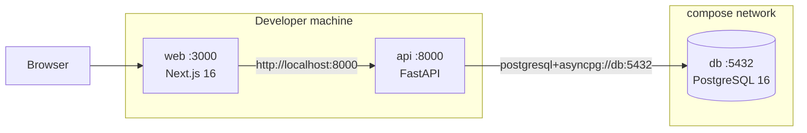

# Docker

> [Handbook index](../README.md) · [Part 6](./README.md) · **Status: Implemented**

## Topology



All published ports bind to `127.0.0.1`, so the stack is not exposed on the
local network by default.

## Services

| Service | Image / build | Port | Health check |
|---------|---------------|------|--------------|
| `db` | `postgres:16-alpine` | 5432 | `pg_isready` |
| `api` | `backend/Dockerfile` | 8000 | `GET /health` every 10s |
| `web` | `frontend/Dockerfile` | 3000 | Depends on API health |

`api` waits for `db` to be healthy; `web` waits for `api`. A failed dependency
stops the chain instead of producing a half-working UI.

## Backend image

Two stages:

1. **build** — `python:3.14-slim` + `uv`; dependencies installed from the
   lockfile with `uv sync --frozen`, cached in a BuildKit mount until
   `pyproject.toml` or `uv.lock` changes.
2. **runtime** — clean `python:3.14-slim`, non-root `appuser` (uid 1001),
   bytecode compilation disabled, `uvicorn` on `0.0.0.0:8000`.

On start the container runs `alembic upgrade head` before `uvicorn`, so a fresh
database volume is usable immediately. That makes the quick start a real
two-command flow (`up`, then `seed`).

```bash
docker build -t vizlify-api ./backend
```

Dependencies are installed before source is copied, so code edits rebuild in
seconds.

## Frontend image

1. **build** — `oven/bun:1`; install with `bun install --frozen-lockfile`,
   then `bun run build`. `NEXT_PUBLIC_API_URL` is a build argument because
   Next.js inlines public variables at build time.
2. **runtime** — `oven/bun:1`, non-root `bun`, `bun run start` on port 3000.

Because the API URL is baked in, a different backend URL requires rebuilding
the web image. That is intentional: production builds should not depend on
runtime environment drift for a public URL.

## Environment

```yaml
api:
  env_file:
    - path: ./backend/.env
      required: false
  environment:
    APP_ENV: development
    DATABASE_URL: postgresql+asyncpg://vizlify:vizlify@db:5432/vizlify
    CORS_ORIGINS: http://localhost:3000
    FRONTEND_URL: http://localhost:3000
    JOBS_MODE: inline
```

- `.env` is optional; the safe defaults are in the application.
- Compose **overrides** `DATABASE_URL` so the API always talks to the `db`
  service, even if the local file points at `localhost`.
- `NEXT_PUBLIC_API_URL` is passed to the web build in `compose.yaml`.

## Commands

```bash
docker compose up --build -d
docker compose ps
docker compose logs -f api
docker compose exec api python -m app.scripts.seed
docker compose exec api alembic upgrade head
docker compose down          # keep the volume
docker compose down -v       # delete the database volume
```

## Volume and data

`db-data` is a named volume mounted at `/var/lib/postgresql/data`. Removing the
container does not remove data; removing the volume does. The seed is
idempotent, so re-seeding after a restart is safe.

## Known limitations

- No Compose health check for `web`; it relies on the port being open.
- No resource limits or logging driver configuration.
- No production Compose override; production is planned on Render.
- The frontend build arg means one image per API URL.

Next: [Deployment](./deployment.md) →
