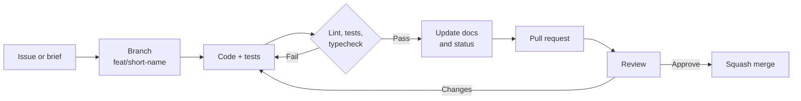

# Contributing

> [Handbook index](../README.md) · [Part 9](./README.md) · **Status: living document**

Vizlify is a hackathon project, but it is built like a small production system.
Contributions are welcome if they keep the safety properties intact.

## Setup

```bash
cp backend/.env.example backend/.env
docker compose up --build -d
docker compose exec api python -m app.scripts.seed

cd backend && uv sync
cd frontend && bun install
```

## Workflow



### Commits

Conventional Commits, one logical change each:

```text
feat(paypal): add invoice send endpoint
fix(auth): reject dev mode in production
docs(handbook): document the approval executor
test(team): cover the share ceiling
chore(docker): cache uv layers
```

The body explains **why**, not a restatement of the diff. If a change alters a
safety property, say so explicitly.

### Branches

`feat/<area>-<short-name>`, `fix/<area>-<short-name>`, `docs/<short-name>`.
Keep them short-lived; rebase on `main` before opening a PR.

## Quality gates

```bash
# backend
cd backend
uv run ruff check .
uv run pytest

# frontend
cd frontend
bun run lint
bun run typecheck
```

A PR that lowers coverage or adds an untested money path will not be merged.

## Code rules

### Backend

- Routers stay thin: validate, authenticate, delegate.
- Services own ownership checks and transactions.
- Never use floats for money. `Decimal` and `NUMERIC(12,2)` only.
- Every new query that returns business data filters by owner.
- Every new external call gets a timeout, a retry rule and a test.
- Never edit an applied migration.
- Add a mock route when adding a PayPal endpoint.

### Frontend

- Components call hooks, never `fetch`.
- Server data stays in TanStack Query.
- Money is a string until rendered.
- Use the shared `DataState` for loading, error and empty views.
- Use theme tokens, not hardcoded colours.
- Every icon-only button gets an `aria-label`.

### Money and safety

Any change touching invoices, payouts, approvals or the agent must answer:

1. Can this run without an approved proposal?
2. Is it idempotent if retried?
3. Is every query owner-scoped?
4. Is there an audit entry?
5. What happens when PayPal returns 429 or 500?
6. What does the UI show when it fails?

If any answer is "no" or "unclear", the change is not ready.

## Documentation rules

- Update the chapter that describes what you changed, in the same PR.
- Update [Product and scope](../01-overview/product-scope.md) and
  [Status](../09-project/status-and-roadmap.md) when a feature changes state.
- Diagrams are Mermaid; keep them small and labelled.
- No dead links. Use relative paths.
- Do not describe planned work as implemented. Use the status markers.
- If a page becomes wrong because code moved, fix the page or delete it.

## Review checklist

- [ ] The change has a test that fails without it.
- [ ] Ownership and validation are covered.
- [ ] Error paths return the correct envelope and status.
- [ ] No secret or raw PayPal body is logged or returned.
- [ ] Docs and status pages are updated.
- [ ] `ruff`, `pytest`, `lint`, `typecheck` pass.
- [ ] The demo path still works from a clean seed.

## Reporting bugs and vulnerabilities

- Functional bug: open an issue with steps, expected and actual behavior.
- Security issue: use GitHub's private vulnerability reporting; do not open a
  public issue. See [Security](../06-operations/security.md).

## Code of conduct

Be direct about code and generous about people. Harassment, discrimination and
personal attacks are not welcome. Maintainers may remove comments or
contributions that violate this.

Next: [License and notices](./license-and-notices.md) →
