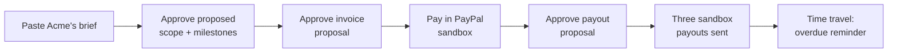

# Judge guide

> [Handbook index](../README.md) · [Part 9](./README.md) · **Status: Scaffolded**

A short path through what works today, and an honest map of the intended demo.

## Run it locally (no keys)

```bash
git clone <repository-url> vizlify
cd vizlify
cp backend/.env.example backend/.env
docker compose up --build -d
docker compose exec api python -m app.scripts.seed
```

Open **http://localhost:3000** and the API docs at
**http://localhost:8000/docs**.

| Item | Value |
|------|-------|
| Local login | `demo@vizlify.space` (no password, `AUTH_MODE=dev`) |
| Seeded agency | Northwind Studio |
| Clients | Acme Co, Globex Corporation |
| Project | Acme website redesign, USD |
| Milestones | $2,500 · $4,000 · $6,000 |
| Team split | Rida 40% · Maya 35% · Sam 25% |
| PayPal | `PAYPAL_MODE=mock`: no network, no keys |
| LLM | `LLM_MODE=mock`: no key (agent not wired yet) |

## What you can verify today

| Check | How |
|-------|-----|
| Health and envelope | `curl http://localhost:8000/health` |
| Seeded data | `curl http://localhost:8000/clients` |
| Owner scoping | Create a second user in a test, confirm rows never cross |
| Validation | `POST /clients` with an invalid email → `422` envelope |
| Team share ceiling | Add members totalling over 100% → `409` |
| Money as strings | Milestone amounts serialize as `"2500.00"` |
| PayPal transport | `cd backend && uv run pytest tests/test_paypal_client.py` |
| Mock PayPal flow | The test suite creates invoices and payouts through the real client |

The API is the product surface right now. The Next.js app renders its shell and
providers but not the dashboard screens yet.

## The intended three-minute demo



Steps and their status:

| Step | Status | Notes |
|------|--------|-------|
| 1. Paste a brief | Planned | Needs the LLM client and brief UI |
| 2. Approve the scope | Planned | Needs proposals and the approval queue |
| 3. Approve the invoice | Planned | Needs invoicing routes and UI |
| 4. Pay as the sandbox payer | Planned | Needs a sent invoice |
| 5. Webhook marks it paid | Planned | Needs the webhook receiver |
| 6. Approve the payout split | Planned | Needs split maths and payout UI |
| 7. Time travel to an overdue reminder | Planned | Needs the demo controls |

When the hosted demo is live, the Clerk account and sandbox payer credentials
will be published here and in the root README. **Never use real accounts.**

## What to look for in the code

| Property | Where to look |
|----------|---------------|
| The agent cannot execute | Proposals table and kind enum; executor is a separate path (planned) |
| Retries cannot duplicate money | `new_request_id` and `PayPal-Request-Id` in `app/paypal/client.py` |
| PayPal failures are contained | `PayPalError` → `502 integration_error`, raw body never returned |
| Exact money | `Numeric(12, 2)` and `Decimal`; strings on the wire |
| No key-free production | `core/config.py` validators |
| Owner isolation | Every service filters by `owner_id` and returns `404` |
| Test discipline | 78 tests, ~96% coverage, no network in tests |

## Known limits

The payment loop is not yet exposed through HTTP. The transport, schema, auth
and CRUD are real and tested; invoices, approvals, webhooks and payouts are the
next milestones. [Project status](./status-and-roadmap.md) lists them in order.

## Troubleshooting

| Symptom | Fix |
|---------|-----|
| `401` on `/clients` | Run the seed; check `DEV_USER_EMAIL` |
| API exits at startup | Check the fail-closed rules in [Environment](../02-getting-started/environment.md) |
| Empty database | The API migrates on start; run the seed command |
| Web app shows the starter page | Expected; screens are the next milestone |
