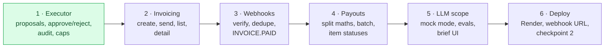

# Status and roadmap

> [Handbook index](../README.md) · [Part 9](./README.md) · **Status: living document — last updated 2026-10-20**

This page is the honest snapshot. It is updated when a milestone lands, not on
a schedule.

## Done

| Layer | What works | Evidence |
|-------|------------|----------|
| Repository | Monorepo, Docker Compose, Dockerfiles, license | `docker compose up` |
| Data | 12 tables, 3 migrations, enums, seed | `pytest tests/test_models.py`, `test_seed.py` |
| Config | Env-only settings, mode validation | `test_paypal_client.py` config tests |
| Auth | Clerk verification, provisioning, dev mode | `test_auth.py` |
| Domain | Clients, projects, milestones, team CRUD | 20 route tests |
| PayPal | OAuth cache, retries, idempotency, mock mode | 33 tests, client 97% covered |
| Frontend | Shell, providers, API client, query hooks | `bun run typecheck` |
| Docs | This handbook, PayPal setup, ADRs | `docs/` |

Run `git log --oneline` for the current history. Commit bodies explain the
reason for a change and any safety property it affects.

## The schedule gap

The roadmap expected the following by **Tue Oct 20**:

| Roadmap day | Planned | Actual |
|-------------|---------|--------|
| Oct 13 | PayPal client, create and send an invoice | PayPal client ✅, invoice routes ❌ |
| Oct 14 | Webhooks, signature verification, `INVOICE.PAID` | ❌ |
| Oct 18 | Invoice UI, approval-queue skeleton, checkpoint 1 | ❌ |
| Oct 19 | Executor: proposals, locks, idempotency, audit, caps | ❌ (tables exist) |
| Oct 20 | Split calculation, Payouts batch | ❌ |

The foundations took longer than planned; the PayPal **transport** is now
ahead of where the roadmap expected it, but nothing is exposed through the API
yet. Checkpoint 1 (create invoice → pay in sandbox → live status) has not been
reached.

## Next milestones

1. **Executor and approval queue** — `pending_actions` service, approve/reject
   with `409` on double approve, immutable audit writes, spend caps. This is the
   safety core and the demo's spine; build it before invoices so no money call
   is ever made outside a proposal.
2. **Invoicing routes** — generate number, create draft, send, remind, cancel;
   invoice list/detail API and UI; milestone `done` creates a proposal.
3. **Webhooks** — signature verification, event store dedupe, `INVOICE.PAID`
   updates status and queues a payout proposal.
4. **Payouts** — deterministic split with largest-remainder rounding, batch
   creation, item statuses, freelancer view.
5. **AI scope** — Cerebras client, structured output, `LLM_MODE=mock`, eval
   harness, brief UI.
6. **Deployment** — first Render deploy, webhook URL, checkpoint 2 recording.

## Known gaps

| Gap | Impact | Status |
|-----|--------|--------|
| No approval executor | Money actions cannot flow end to end | Next |
| No invoice or payout routes | PayPal transport is unreachable from the app | Next |
| No webhook receiver | Status never updates from PayPal | Next |
| No LLM client | Brief-to-scope is not implemented | Week 2–3 |
| No real screens | Demo is API-only | Week 2–3 |
| No AG Studio | Money Board widget is missing | Week 3 |
| No CI workflow | Tests are local only | Before deploy |
| No frontend tests | Regressions caught manually | After screens |
| No rate limiting or headers | Hardening incomplete | Week 4 |
| `docs/apimatic.md` missing | Sponsor evidence incomplete | Before submission |

## Risks

| Risk | Likelihood | Mitigation |
|------|------------|------------|
| PayPal sandbox quirks (payout funding, enabled features) | Medium | Test early; mock mode keeps development unblocked |
| Webhooks unreachable locally | High | cloudflared tunnel; replay fixtures |
| AG Studio trial key unavailable | Medium | Dashboard degrades to plain components |
| Schedule slip | High | Cut P2, then P1; never cut the approval gate |
| Frontend scope too large | Medium | Ship the critical path screens only |

## Definition of a finished milestone

- Code, tests and docs are in the same pull request.
- The demo path works from a clean database.
- `ruff`, `pytest`, `lint` and `typecheck` pass.
- This page and [Product and scope](../01-overview/product-scope.md) are updated.
- A judge can run it without reading source code.

Next: [Contributing](./contributing.md) →
