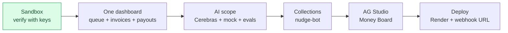

# Status and roadmap

> [Handbook index](../README.md) · [Part 9](./README.md) · **Status: living document — last updated 2026-10-21**

This page is the honest snapshot. It is updated when a milestone lands, not on
a schedule. The short, actionable version for API keys and next steps is
[`TODO.md`](../../TODO.md).

## Done

| Layer | What works | Evidence |
|-------|------------|----------|
| Repository | Monorepo, Docker Compose, Dockerfiles, license | `docker compose up` |
| Data | 12 tables, 4 migrations, enums, seed | `test_models.py`, `test_seed.py` |
| Config | Env-only settings, mode validation, spend caps | config tests |
| Auth | Clerk verification, provisioning, dev mode | `test_auth.py` |
| Domain | Clients, projects, milestones, team CRUD | 20 route tests |
| PayPal | OAuth cache, retries, idempotency, mock mode | 33 tests, client 97% covered |
| Approvals | Propose, list, approve, reject, `409`, audit, caps | `test_actions.py` |
| Invoicing | Create/send, list/detail, remind, cancel, refresh | `test_invoices.py` |
| Webhooks | Verify, dedupe, invoice/payout/item handlers | `test_webhooks.py` |
| Payouts | Largest-remainder split, prepare, execute | `test_payouts.py` |
| Frontend | Shell, providers, API client, money hooks | `bun run typecheck` |
| Dashboard | `/dashboard`: approvals, invoices, payouts, sandbox banner | Rendered on Docker |
| Docs | This handbook, judge guide, ADRs | `docs/` |

The full mock loop (milestone → invoice → paid webhook → payout batch) was run
against Docker on 2026-10-21 and then reset to a clean seed.

**108 backend tests, 91% statement coverage.** Frontend lint and typecheck are
clean.

## The schedule gap

The roadmap expected this by **Tue Oct 20**:

| Roadmap day | Planned | Actual |
|-------------|---------|--------|
| Oct 13 | PayPal client, create and send an invoice | ✅ (21 Oct) |
| Oct 14 | Webhooks, signature verification, `INVOICE.PAID` | ✅ (21 Oct) |
| Oct 18 | Invoice UI, approval-queue skeleton, checkpoint 1 | ❌ API only |
| Oct 19 | Executor: proposals, locks, idempotency, audit, caps | ✅ (21 Oct) |
| Oct 20 | Split calculation, Payouts batch | ✅ (21 Oct) |

The **backend money loop is now ahead of the original gap**; the remaining debt
is the UI, sandbox verification, AI scope and AG Studio. Checkpoint 1 can be
recorded as soon as sandbox keys are in place.

## Next milestones

1. **Sandbox verification** — add PayPal keys, tunnel the API, create/pay an
   invoice, confirm the webhook and payout batch. This is the only way to prove
   the integration beyond the mock.
2. **One dashboard screen** — approval queue, invoices and payouts on one page,
   with approve/reject and the sandbox banner. No AG Studio.
3. **AI scope** — Cerebras client, `LLM_MODE=mock`, structured output, eval
   harness, brief UI.
4. **Collections** — overdue sweep and tone-aware reminders.
5. **AG Studio** — three P0 widgets and the Agent Framework (parked by request
   until the above is done).
6. **Deployment** — Render, custom domain, webhook URL, checkpoint recording.

## Known gaps

| Gap | Impact | Status |
|-----|--------|--------|
| No screens | Demo is API-only | Next |
| No real sandbox verification | Mock proves logic, not PayPal wiring | Needs keys from you |
| No LLM client | Brief-to-scope is not implemented | After the screen |
| No AG Studio | Money Board widget is missing | Parked |
| No CI workflow | Tests are local only | After the demo path |
| No frontend tests | Regressions caught manually | After screens |
| No rate limiting or headers | Hardening incomplete | Before hosting |
| Failed actions cannot be retried | A failed proposal stays failed | Later |
| `docs/apimatic.md` missing | Sponsor evidence incomplete | Before submission |

## Risks

| Risk | Likelihood | Mitigation |
|------|------------|------------|
| PayPal sandbox quirks (payout funding, enabled features) | Medium | Test as soon as keys arrive |
| Webhooks unreachable locally | High | cloudflared tunnel; mock mode for development |
| AG Studio trial expires before judging | Medium | Request an extension; keep screenshots |
| Schedule slip | High | Cut P2, then P1; never cut the approval gate |
| Frontend scope too large | Medium | Ship the critical path screens only |

## Definition of a finished milestone

- Code, tests and docs are in the same pull request.
- The demo path works from a clean database.
- `ruff`, `pytest`, `lint` and `typecheck` pass.
- This page, [Product and scope](../01-overview/product-scope.md) and
  [`TODO.md`](../../TODO.md) are updated.
- A judge can run it without reading source code.

Next: [Judge guide](./judge-guide.md) →
