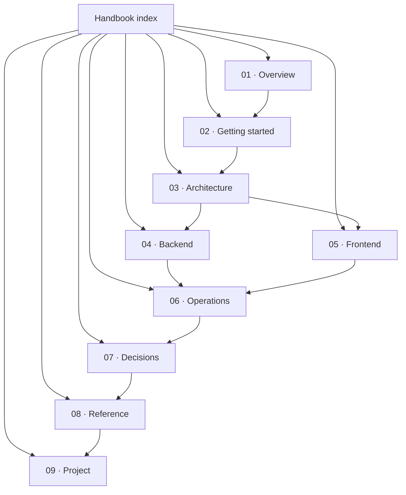

# The Vizlify Handbook

> An AI agent that proposes, a human approves, PayPal executes.

Vizlify is an approval-gated finance agent for freelance agencies. It drafts a
scope from a client brief, bills milestones through PayPal, chases overdue
invoices, and prepares team payouts. **The agent can only propose. Nothing moves
until a human approves it.**

This handbook is the single source of truth for how the project is built and
how it is meant to grow. It covers what exists today, what is scaffolded, and
what is still planned — with the same honesty in all three cases.

- New here? Read [What is Vizlify?](./01-overview/what-is-vizlify.md) then
  [Quick start](./02-getting-started/quick-start.md).
- Judging or reviewing? Read [Product and scope](./01-overview/product-scope.md)
  and [Project status](./09-project/status-and-roadmap.md).
- Contributing? Read [Architecture](./03-architecture/system-overview.md) and
  [Contributing](./09-project/contributing.md).

## Status legend

Every page marks its state with one of these:

| Marker | Meaning |
|--------|---------|
| **Implemented** | In the repository, covered by tests where practical, safe to rely on |
| **Scaffolded** | Structure exists (models, providers, docs) but the feature is incomplete |
| **Planned** | Designed only; no production code yet |

## The book

### Part 1 — Overview

| Chapter | What it answers |
|---------|-----------------|
| [What is Vizlify?](./01-overview/what-is-vizlify.md) | The problem, the actors, the promise |
| [Product and scope](./01-overview/product-scope.md) | Every feature area and its real status |
| [Tech stack](./01-overview/tech-stack.md) | Every technology, version and why it is there |

### Part 2 — Getting started

| Chapter | What it answers |
|---------|-----------------|
| [Quick start](./02-getting-started/quick-start.md) | Running the whole stack in about five minutes |
| [Environment](./02-getting-started/environment.md) | Every variable, mode and fail-closed rule |
| [Project structure](./02-getting-started/project-structure.md) | Where code and docs live |

### Part 3 — Architecture

| Chapter | What it answers |
|---------|-----------------|
| [System overview](./03-architecture/system-overview.md) | Components, boundaries, data flow |
| [Request lifecycle](./03-architecture/request-lifecycle.md) | One API call, end to end |
| [Data model](./03-architecture/data-model.md) | Tables, relationships, money rules |

### Part 4 — Backend

| Chapter | What it answers |
|---------|-----------------|
| [API conventions](./04-backend/api-conventions.md) | The envelope, errors, validation |
| [Authentication](./04-backend/authentication.md) | Clerk, dev mode, provisioning, ownership |
| [Domain API](./04-backend/domain-api.md) | Clients, projects, milestones, team |
| [Database](./04-backend/database.md) | SQLAlchemy models, Alembic, seeding |
| [PayPal client](./04-backend/paypal-client.md) | OAuth cache, retries, idempotency, mock mode |
| [Testing](./04-backend/testing.md) | Fixtures, coverage, how to add tests |

### Part 5 — Frontend

| Chapter | What it answers |
|---------|-----------------|
| [App shell](./05-frontend/app-shell.md) | Next.js layout, providers, Clerk |
| [API client](./05-frontend/api-client.md) | One HTTP entry point and typed errors |
| [Server state](./05-frontend/server-state.md) | TanStack Query keys, mutations, optimistic updates |
| [Design system](./05-frontend/design-system.md) | shadcn/ui, Tailwind v4, theming |

### Part 6 — Operations

| Chapter | What it answers |
|---------|-----------------|
| [Docker](./06-operations/docker.md) | The three-service local stack |
| [Deployment](./06-operations/deployment.md) | Render topology and the go-live checklist |
| [Security](./06-operations/security.md) | Authz, secrets, webhooks, sandbox guarantees |

### Part 7 — Decisions

| Chapter | Decision |
|---------|----------|
| [ADR-0001](./07-decisions/adr-0001-thin-paypal-client.md) | A thin async PayPal client over a generated SDK |
| [ADR-0002](./07-decisions/adr-0002-clerk-with-dev-mode.md) | Clerk with a fail-closed local `dev` mode |
| [ADR-0003](./07-decisions/adr-0003-tanstack-query.md) | TanStack Query as the only server-state layer |

### Part 8 — Reference

| Chapter | What it answers |
|---------|-----------------|
| [API endpoints](./08-reference/api-endpoints.md) | Every route, payload and status code |
| [Error codes](./08-reference/error-codes.md) | Code → HTTP status → meaning |
| [Glossary](./08-reference/glossary.md) | Invoice, payout, proposal, milestone, … |

### Part 9 — Project

| Chapter | What it answers |
|---------|-----------------|
| [Status and roadmap](./09-project/status-and-roadmap.md) | What is done, what slipped, what is next |
| [Judge guide](./09-project/judge-guide.md) | Run it, verify it, know the limits |
| [Contributing](./09-project/contributing.md) | Workflow, style, review checklist |
| [License and notices](./09-project/license-and-notices.md) | MIT, third-party licenses, trademarks |

## How the book is organised

## Conventions

- **Diagrams** are [Mermaid](https://mermaid.js.org/) so they render on GitHub
  and stay reviewable as text.
- **Code blocks** are real excerpts. When they drift, the excerpt is a bug.
- **Links** are relative, so the handbook works offline and on any Git host.
- **Status markers** are updated in the same pull request that changes the
  feature. A page that says "Implemented" is a promise.
- **Placeholders** are explicit: `*(replace)*` means a human must fill it in.
  Nothing in the docs pretends a planned feature already works.

## Related documents

- [README](../README.md) — the pitch and the five-minute start.
- [ROADMAP](../ROADMAP.md) — the full hackathon plan, day by day.
- [LICENSE](../LICENSE) — MIT.
